# Paper (32): every figure, with where AMTP wins and loses

Generated by `baselines/figure_catalog.py` from `figures/figure_points.csv` (no number is typed by hand).
Figures are built by `baselines/plot_p32.py` (line charts, png + pdf). Every timing is the mean of 10 runs after
3 warm-up runs; a query-level point is the median over the queries of that x, with interquartile-range bars;
Exp. 3, Exp. 4, update isolation and Sepolia points are means over runs / batches / updates.

Each comparison line says at which x AMTP is better and at which the baseline is better, with the factor
(how many times better). Lower is better for times, sizes, gas and partition sizes; higher is better for
throughput, detection rate and attack types detected. Within 2% = tie.

**In paper:** `24 p.` = the 24-page version AMTP (36); `6 p.` = the 6-page conference draft. A figure with no
tag is in neither version (some of its numbers may be quoted in the text).

Contents: [Exp. 1](#experiment-1-boolean-search-scalability) · [Exp. 2](#experiment-2-selective-proof-verification-and-tamper-detection) · [Exp. 3](#experiment-3-dynamic-update-scalability) · [Exp. 4](#experiment-4-adaptive-partitioning-under-skewed-growth-ablation) · [Exp. 5](#experiment-5-multi-domain-scalability-and-isolation)

## Experiment 1: Boolean search scalability

### `e1_single_kq_search` (24 p.: Fig. 3 · 6 p.: Fig. 3)

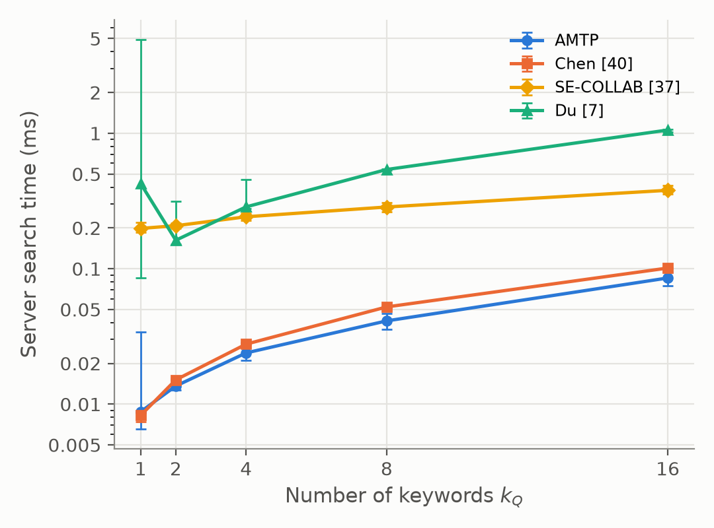

Data: `data/p32_ex1_search1_w6 search_single N=100000`. server search = posting retrieval + Boolean evaluation, no proof, no fetch; Chen's server does not evaluate the AND (the DU ANDs the decrypted bitmaps); Du = slowest cloud

- **vs Chen [40]:** AMTP better at kQ = 2, 4, 8, 16 (1.11–1.27×); Chen [40] better at kQ = 1 (1.06×)
- **vs SE-COLLAB [37]:** AMTP better at kQ = 1, 2, 4, 8, 16 (4.44–22.58×)
- **vs Du [7]:** AMTP better at kQ = 1, 2, 4, 8, 16 (11.91–48.40×)
- AMTP: 0.00879–0.0854 ms over kQ = 1…16

### `e1_single_n_search`

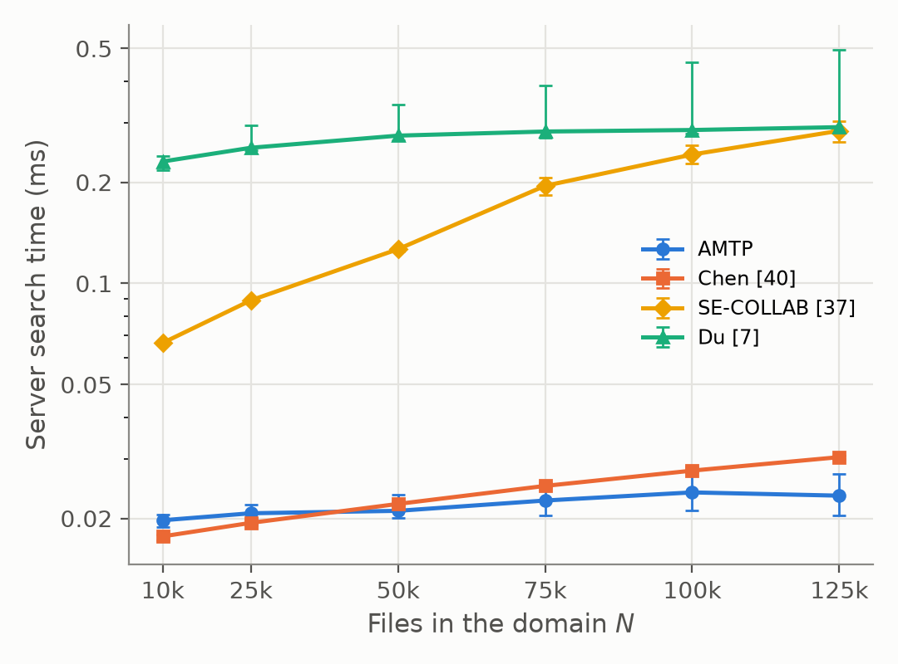

Data: `data/p32_ex1_search1_w6 search_single kQ=4`. server search = posting retrieval + Boolean evaluation, no proof, no fetch; Chen's server does not evaluate the AND (the DU ANDs the decrypted bitmaps); Du = slowest cloud

- **vs Chen [40]:** AMTP better at N = 50,000, 75,000, 100,000, 125,000 (1.05–1.30×); Chen [40] better at N = 10,000, 25,000 (1.07–1.12×)
- **vs SE-COLLAB [37]:** AMTP better at N = 10,000, 25,000, 50,000, 75,000, 100,000, 125,000 (3.37–12.18×)
- **vs Du [7]:** AMTP better at N = 10,000, 25,000, 50,000, 75,000, 100,000, 125,000 (11.68–13.07×)
- AMTP: 0.0197–0.0239 ms over N = 10,000…125,000

### `e1_single_kq_query_gen`

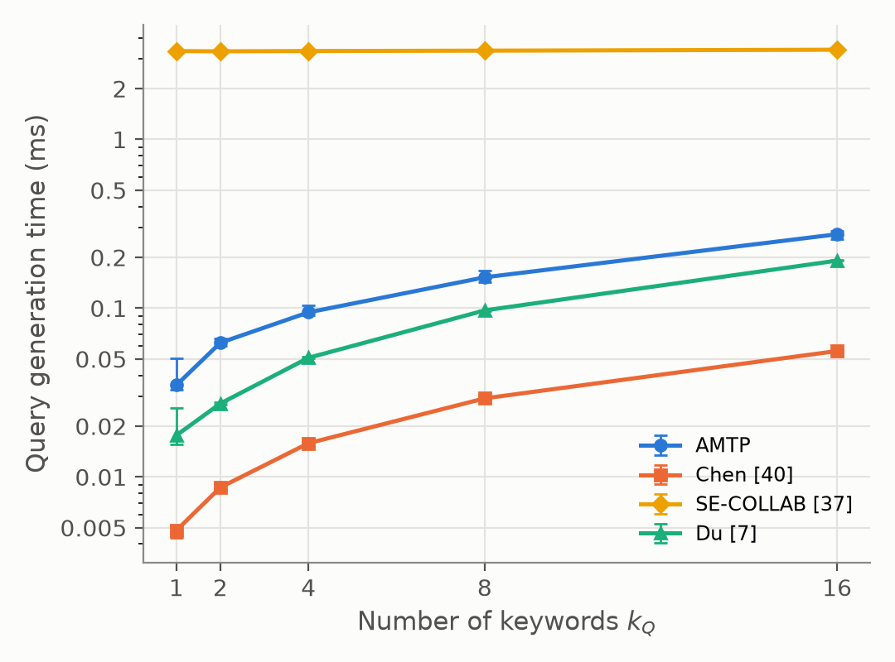

Data: `data/p32_ex1_search1_w6 search_single N=100000`

- **vs Chen [40]:** Chen [40] better at kQ = 1, 2, 4, 8, 16 (4.92–7.25×)
- **vs SE-COLLAB [37]:** AMTP better at kQ = 1, 2, 4, 8, 16 (12.40–95.50×)
- **vs Du [7]:** Du [7] better at kQ = 1, 2, 4, 8, 16 (1.43–2.29×)
- AMTP: 0.035–0.274 ms over kQ = 1…16

### `e1_single_n_query_gen`

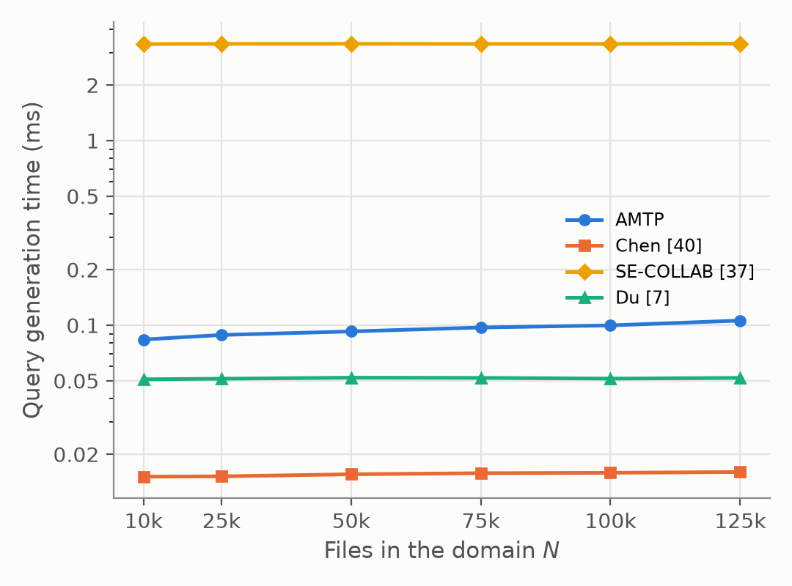

Data: `data/p32_ex1_search1_w6 search_single kQ=4`

- **vs Chen [40]:** Chen [40] better at N = 10,000, 25,000, 50,000, 75,000, 100,000, 125,000 (5.53–6.17×)
- **vs SE-COLLAB [37]:** AMTP better at N = 10,000, 25,000, 50,000, 75,000, 100,000, 125,000 (33.79–40.10×)
- **vs Du [7]:** Du [7] better at N = 10,000, 25,000, 50,000, 75,000, 100,000, 125,000 (1.64–1.93×)
- AMTP: 0.0833–0.0992 ms over N = 10,000…125,000

### `e1_single_kq_server`

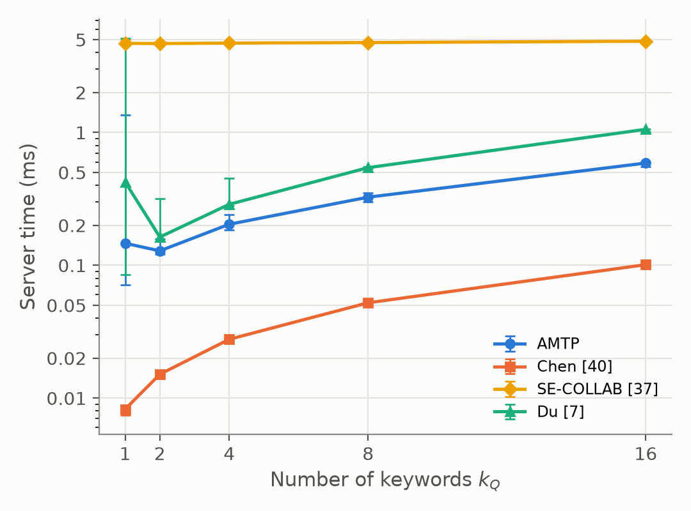

Data: `data/p32_ex1_search1_w6 search_single N=100000`

- **vs Chen [40]:** Chen [40] better at kQ = 1, 2, 4, 8, 16 (5.82–17.74×)
- **vs SE-COLLAB [37]:** AMTP better at kQ = 1, 2, 4, 8, 16 (8.27–36.40×)
- **vs Du [7]:** AMTP better at kQ = 1, 2, 4, 8, 16 (1.27–2.89×)
- AMTP: 0.128–0.589 ms over kQ = 1…16

### `e1_single_n_server`

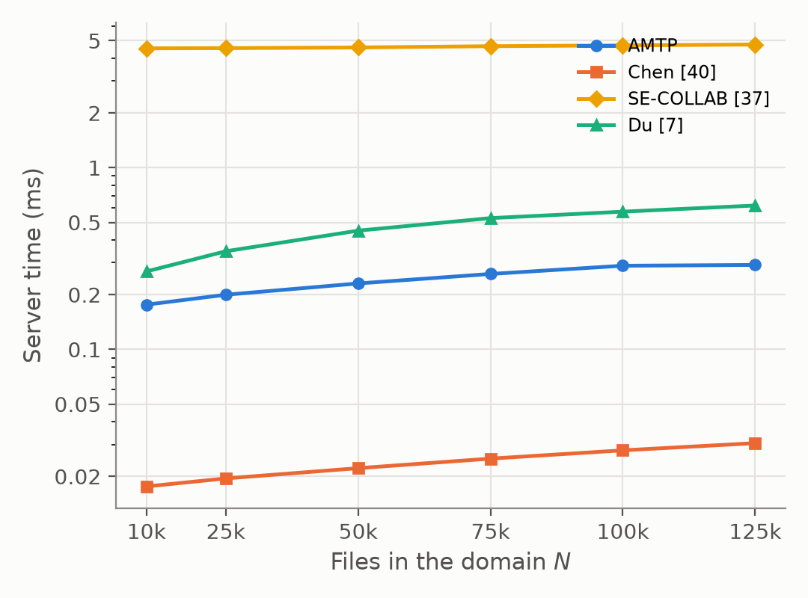

Data: `data/p32_ex1_search1_w6 search_single kQ=4`

- **vs Chen [40]:** Chen [40] better at N = 10,000, 25,000, 50,000, 75,000, 100,000, 125,000 (6.65–9.54×)
- **vs SE-COLLAB [37]:** AMTP better at N = 10,000, 25,000, 50,000, 75,000, 100,000, 125,000 (23.13–26.97×)
- **vs Du [7]:** AMTP better at N = 10,000, 25,000, 50,000, 75,000, 100,000, 125,000 (1.37–1.51×)
- AMTP: 0.169–0.204 ms over N = 10,000…125,000

### `e1_single_kq_e2e`

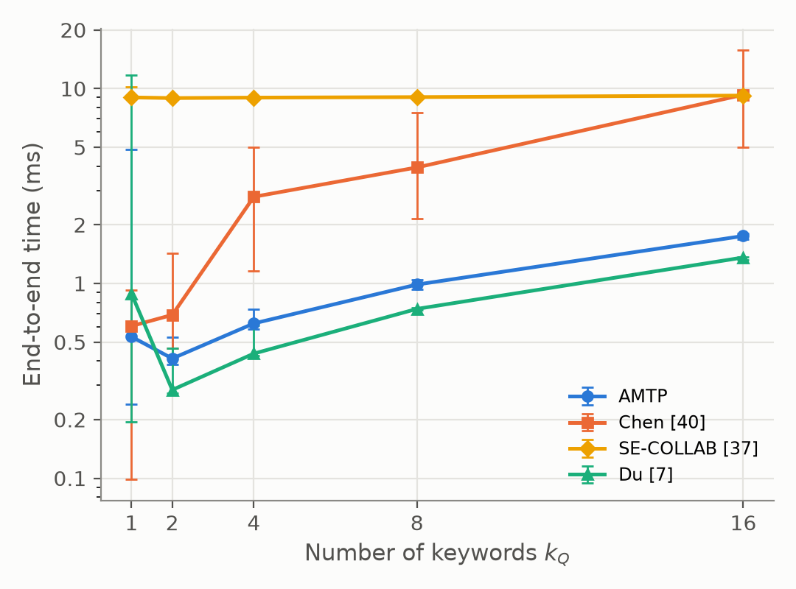

Data: `data/p32_ex1_search1_w6 search_single N=100000`. query generation + server + DU verification; record decryption and AMTP's root read excluded

- **vs Chen [40]:** AMTP better at kQ = 1, 2, 4, 8, 16 (1.13–5.31×)
- **vs SE-COLLAB [37]:** AMTP better at kQ = 1, 2, 4, 8, 16 (5.26–21.71×)
- **vs Du [7]:** AMTP better at kQ = 1 (1.66×); Du [7] better at kQ = 2, 4, 8, 16 (1.29–1.45×)
- AMTP: 0.412–1.75 ms over kQ = 1…16

### `e1_single_n_e2e`

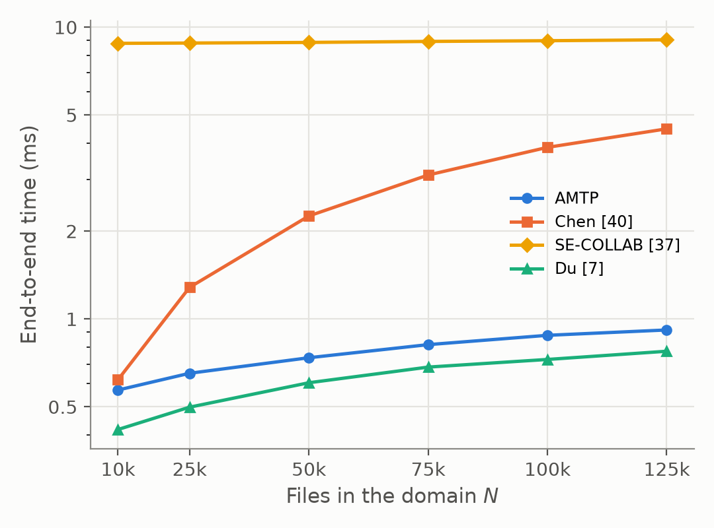

Data: `data/p32_ex1_search1_w6 search_single kQ=4`. query generation + server + DU verification; record decryption and AMTP's root read excluded

- **vs Chen [40]:** AMTP better at N = 25,000, 50,000, 75,000, 100,000, 125,000 (1.54–5.08×); Chen [40] better at N = 10,000 (1.22×)
- **vs SE-COLLAB [37]:** AMTP better at N = 10,000, 25,000, 50,000, 75,000, 100,000, 125,000 (14.24–16.33×)
- **vs Du [7]:** Du [7] better at N = 10,000, 25,000, 50,000, 75,000, 100,000, 125,000 (1.37–1.45×)
- AMTP: 0.54–0.636 ms over N = 10,000…125,000

### `e1_single_kq_verify`

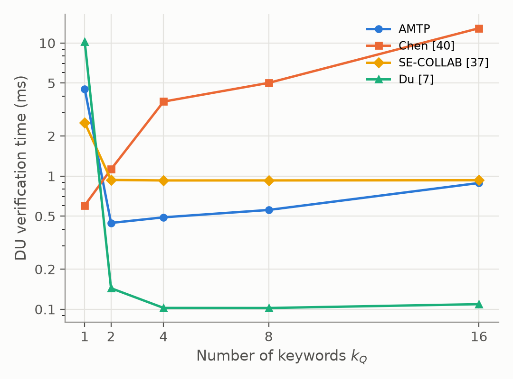

Data: `data/p32_ex1_search1_w6 search_single N=100000`

- **vs Chen [40]:** AMTP better at kQ = 2, 4, 8, 16 (2.55–9.48×); Chen [40] better at kQ = 1 (1.25×)
- **vs SE-COLLAB [37]:** AMTP better at kQ = 1, 2, 4, 8, 16 (1.05–4.26×)
- **vs Du [7]:** AMTP better at kQ = 1 (1.26×); Du [7] better at kQ = 2, 4, 8, 16 (2.29–8.12×)
- AMTP: 0.218–0.886 ms over kQ = 1…16

### `e1_single_n_verify`

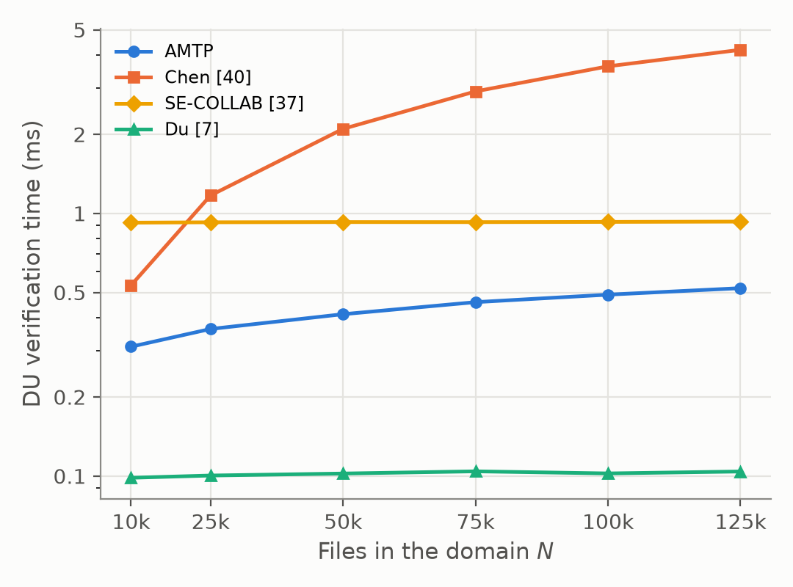

Data: `data/p32_ex1_search1_w6 search_single kQ=4`

- **vs Chen [40]:** AMTP better at N = 10,000, 25,000, 50,000, 75,000, 100,000, 125,000 (1.22–8.90×)
- **vs SE-COLLAB [37]:** AMTP better at N = 10,000, 25,000, 50,000, 75,000, 100,000, 125,000 (2.81–3.20×)
- **vs Du [7]:** Du [7] better at N = 10,000, 25,000, 50,000, 75,000, 100,000, 125,000 (2.97–3.37×)
- AMTP: 0.288–0.331 ms over N = 10,000…125,000

### `e1_multi_AND_search`

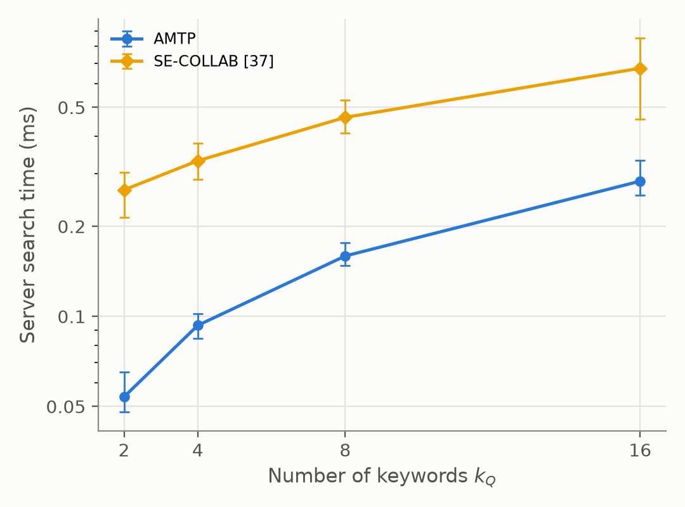

Data: `data/p32_x_search_verify_w8 search_multi shape=AND (4 domains)`. server search = posting retrieval + Boolean evaluation, no proof, no fetch; Chen's server does not evaluate the AND (the DU ANDs the decrypted bitmaps); Du = slowest cloud; SE-COLLAB only (multi-domain Boolean)

- **vs SE-COLLAB [37]:** AMTP better at kQ = 2, 4, 8, 16 (2.39–4.92×)
- AMTP: 0.0538–0.283 ms over kQ = 2…16

### `e1_multi_AND_e2e`

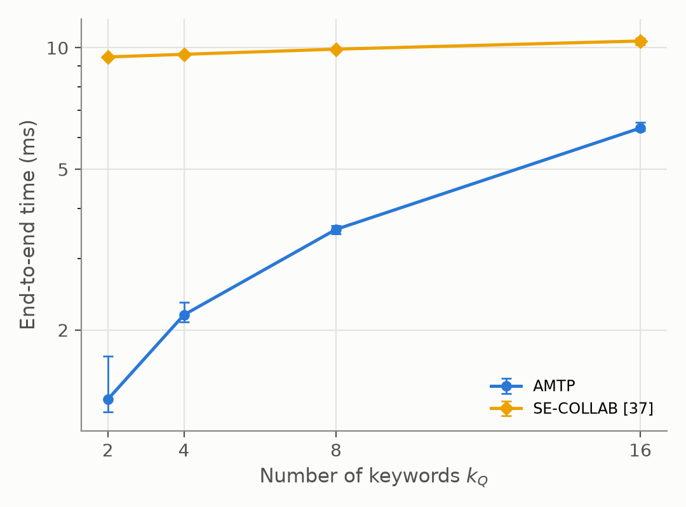

Data: `data/p32_x_search_verify_w8 search_multi shape=AND (4 domains)`. SE-COLLAB only (multi-domain Boolean)

- **vs SE-COLLAB [37]:** AMTP better at kQ = 2, 4, 8, 16 (1.64–7.04×)
- AMTP: 1.35–6.33 ms over kQ = 2…16

### `e1_multi_AND_query_gen`

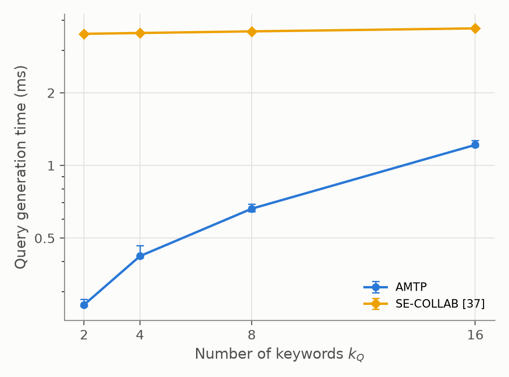

Data: `data/p32_x_search_verify_w8 search_multi shape=AND (4 domains)`. SE-COLLAB only (multi-domain Boolean)

- **vs SE-COLLAB [37]:** AMTP better at kQ = 2, 4, 8, 16 (3.04–13.27×)
- AMTP: 0.265–1.22 ms over kQ = 2…16

### `e1_multi_AND_server`

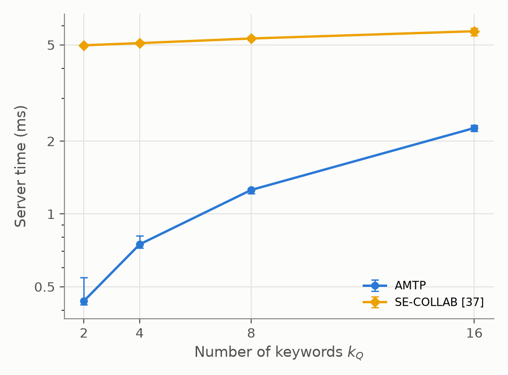

Data: `data/p32_x_search_verify_w8 search_multi shape=AND (4 domains)`. SE-COLLAB only (multi-domain Boolean)

- **vs SE-COLLAB [37]:** AMTP better at kQ = 2, 4, 8, 16 (2.51–11.41×)
- AMTP: 0.437–2.27 ms over kQ = 2…16

### `e1_multi_AND_verify`

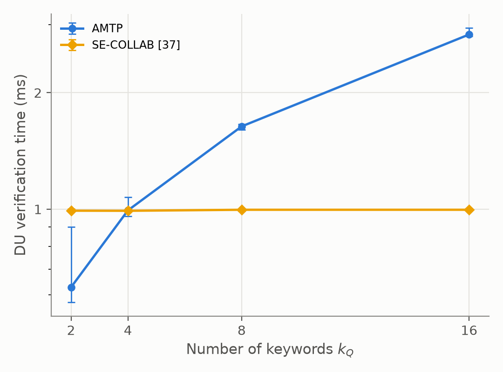

Data: `data/p32_x_search_verify_w8 search_multi shape=AND (4 domains)`. SE-COLLAB only (multi-domain Boolean)

- **vs SE-COLLAB [37]:** AMTP better at kQ = 2 (1.58×); SE-COLLAB [37] better at kQ = 8, 16 (1.64–2.84×); tie at kQ = 4
- AMTP: 0.628–2.83 ms over kQ = 2…16

### `e1_multi_OR_search`

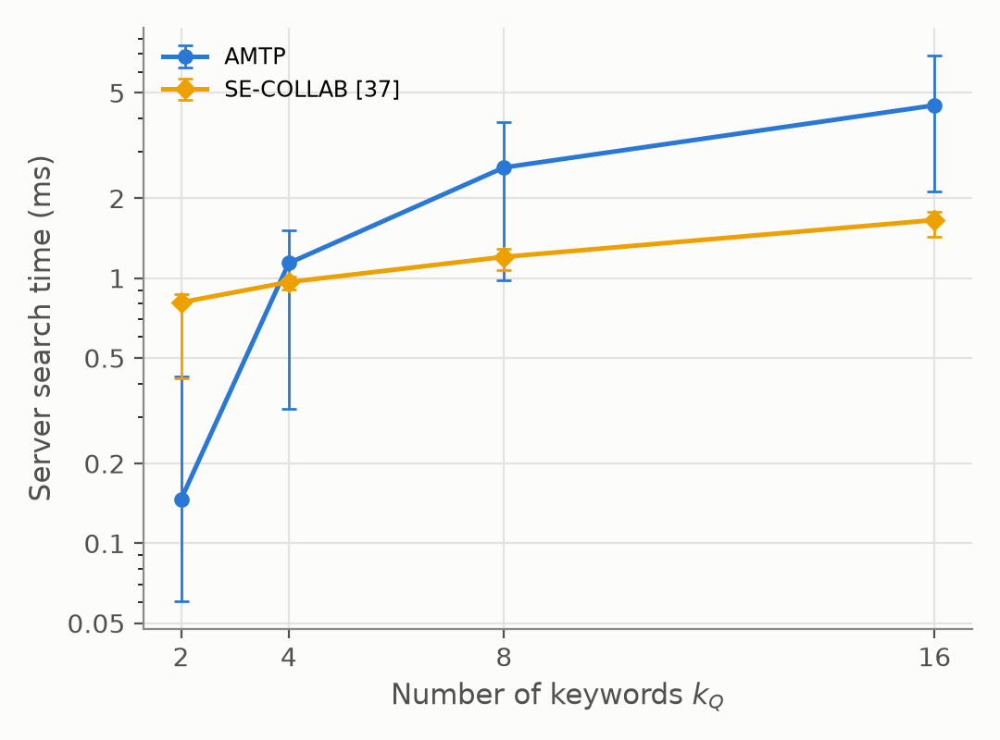

Data: `data/p32_x_search_verify_w8 search_multi shape=OR (4 domains)`. server search = posting retrieval + Boolean evaluation, no proof, no fetch; Chen's server does not evaluate the AND (the DU ANDs the decrypted bitmaps); Du = slowest cloud; SE-COLLAB only (multi-domain Boolean)

- **vs SE-COLLAB [37]:** AMTP better at kQ = 2 (5.53×); SE-COLLAB [37] better at kQ = 4, 8, 16 (1.18–2.71×)
- AMTP: 0.147–4.49 ms over kQ = 2…16

### `e1_multi_OR_e2e`

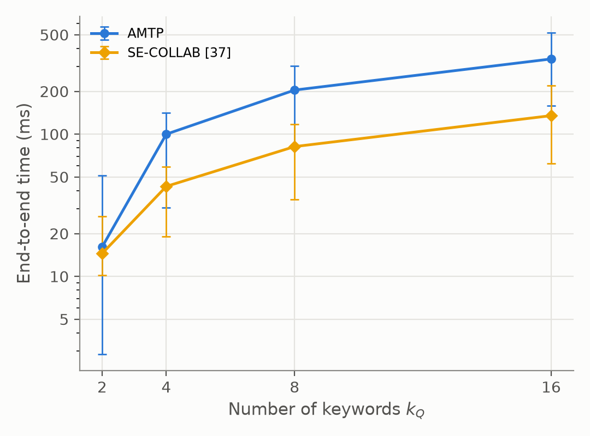

Data: `data/p32_x_search_verify_w8 search_multi shape=OR (4 domains)`. SE-COLLAB only (multi-domain Boolean)

- **vs SE-COLLAB [37]:** SE-COLLAB [37] better at kQ = 2, 4, 8, 16 (1.11–2.50×)
- AMTP: 16.1–338 ms over kQ = 2…16

### `e1_multi_OR_query_gen`

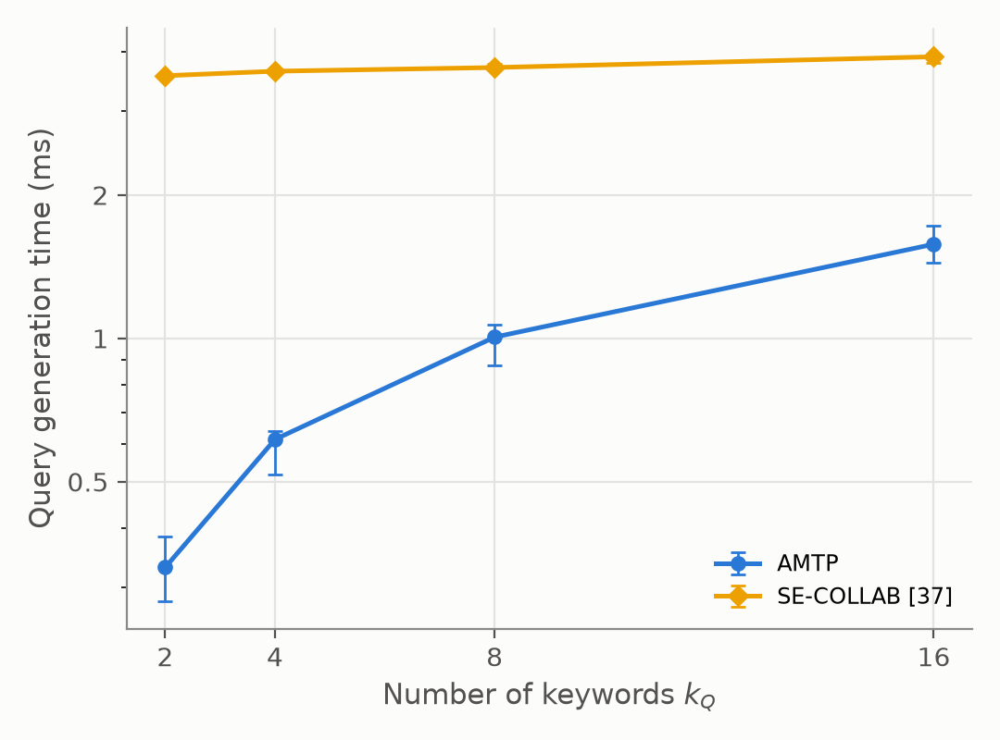

Data: `data/p32_x_search_verify_w8 search_multi shape=OR (4 domains)`. SE-COLLAB only (multi-domain Boolean)

- **vs SE-COLLAB [37]:** AMTP better at kQ = 2, 4, 8, 16 (2.48–10.78×)
- AMTP: 0.33–1.58 ms over kQ = 2…16

### `e1_multi_OR_server`

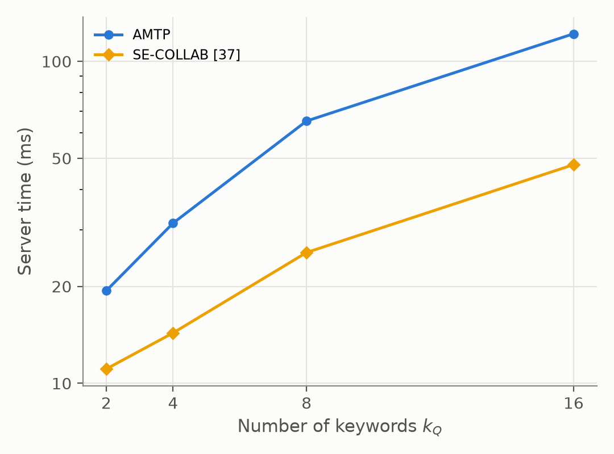

Data: `data/p32_x_search_verify_w8 search_multi shape=OR (4 domains)`. SE-COLLAB only (multi-domain Boolean)

- **vs SE-COLLAB [37]:** AMTP better at kQ = 2 (1.43×); SE-COLLAB [37] better at kQ = 4, 8, 16 (2.30–2.73×)
- AMTP: 4.69–106 ms over kQ = 2…16

### `e1_multi_OR_verify`

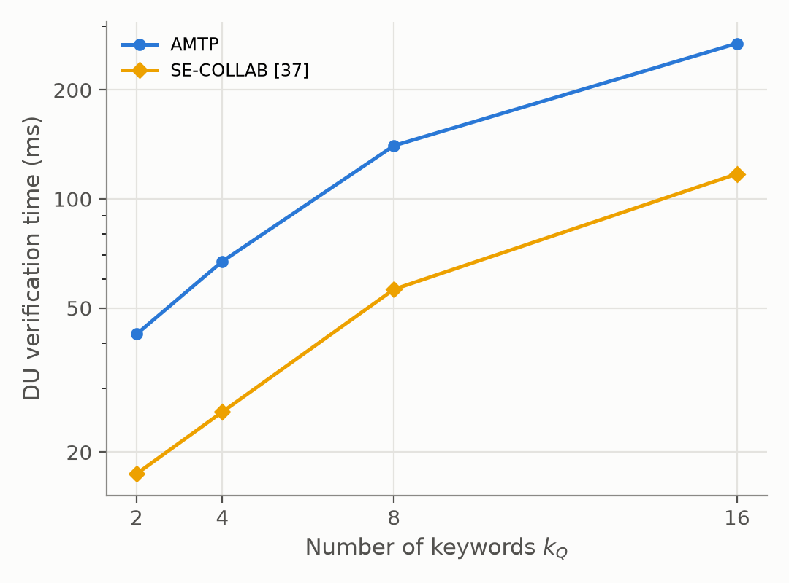

Data: `data/p32_x_search_verify_w8 search_multi shape=OR (4 domains)`. SE-COLLAB only (multi-domain Boolean)

- **vs SE-COLLAB [37]:** SE-COLLAB [37] better at kQ = 2, 4, 8, 16 (2.50–2.66×)
- AMTP: 11.1–231 ms over kQ = 2…16

### `e1_multi_AND_of_OR_search` (24 p.: Fig. 4)

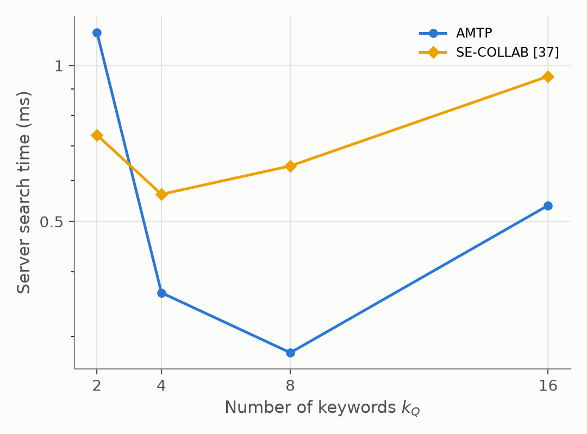

Data: `data/p32_x_search_verify_w8 search_multi shape=AND_of_OR (4 domains)`. server search = posting retrieval + Boolean evaluation, no proof, no fetch; Chen's server does not evaluate the AND (the DU ANDs the decrypted bitmaps); Du = slowest cloud; SE-COLLAB only (multi-domain Boolean)

- **vs SE-COLLAB [37]:** AMTP better at kQ = 2, 4, 8, 16 (1.84–7.80×)
- AMTP: 0.102–0.511 ms over kQ = 2…16

### `e1_multi_AND_of_OR_e2e`

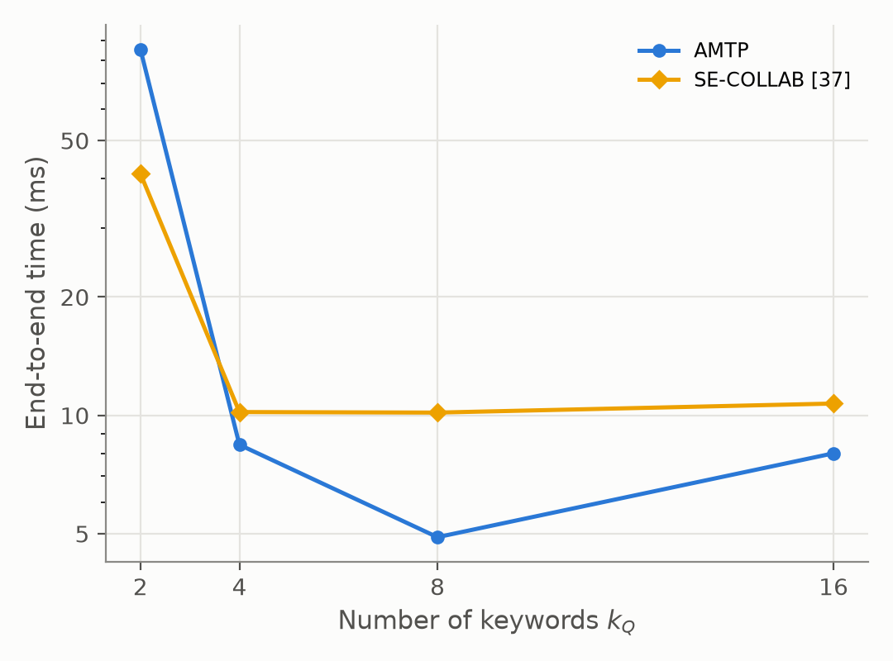

Data: `data/p32_x_search_verify_w8 search_multi shape=AND_of_OR (4 domains)`. SE-COLLAB only (multi-domain Boolean)

- **vs SE-COLLAB [37]:** AMTP better at kQ = 2, 4, 8, 16 (1.37–2.93×)
- AMTP: 3.38–7.79 ms over kQ = 2…16

### `e1_multi_AND_of_OR_query_gen`

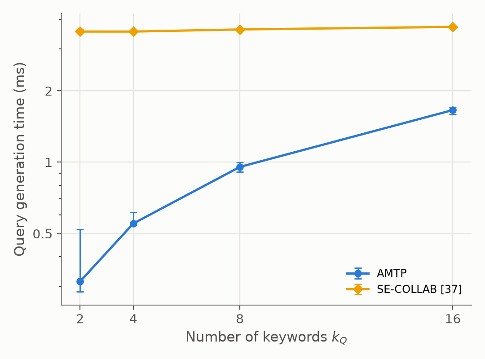

Data: `data/p32_x_search_verify_w8 search_multi shape=AND_of_OR (4 domains)`. SE-COLLAB only (multi-domain Boolean)

- **vs SE-COLLAB [37]:** AMTP better at kQ = 2, 4, 8, 16 (2.24–11.31×)
- AMTP: 0.314–1.66 ms over kQ = 2…16

### `e1_multi_AND_of_OR_server`

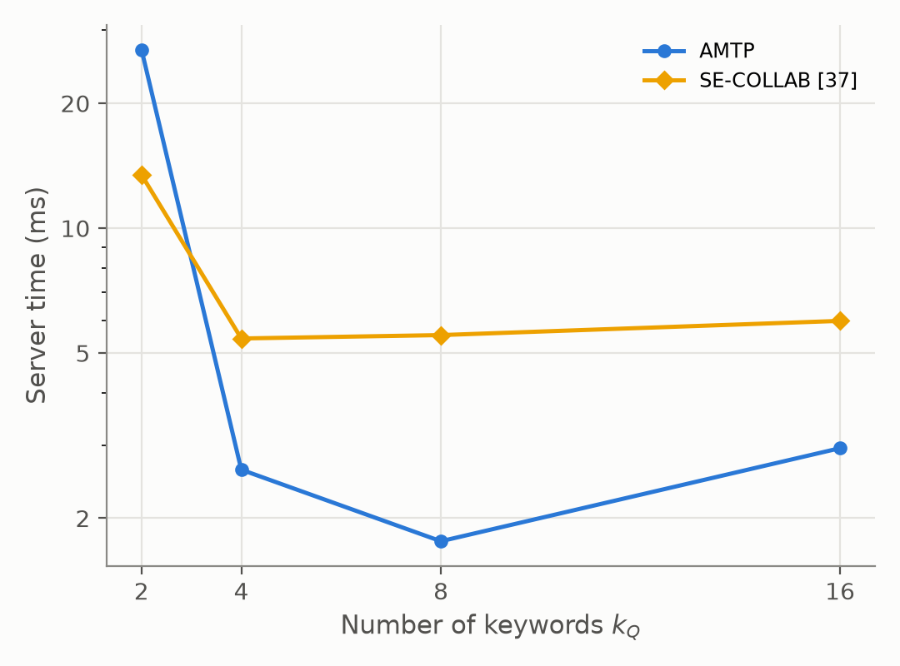

Data: `data/p32_x_search_verify_w8 search_multi shape=AND_of_OR (4 domains)`. SE-COLLAB only (multi-domain Boolean)

- **vs SE-COLLAB [37]:** AMTP better at kQ = 2, 4, 8, 16 (2.14–4.88×)
- AMTP: 1.09–2.79 ms over kQ = 2…16

### `e1_multi_AND_of_OR_verify`

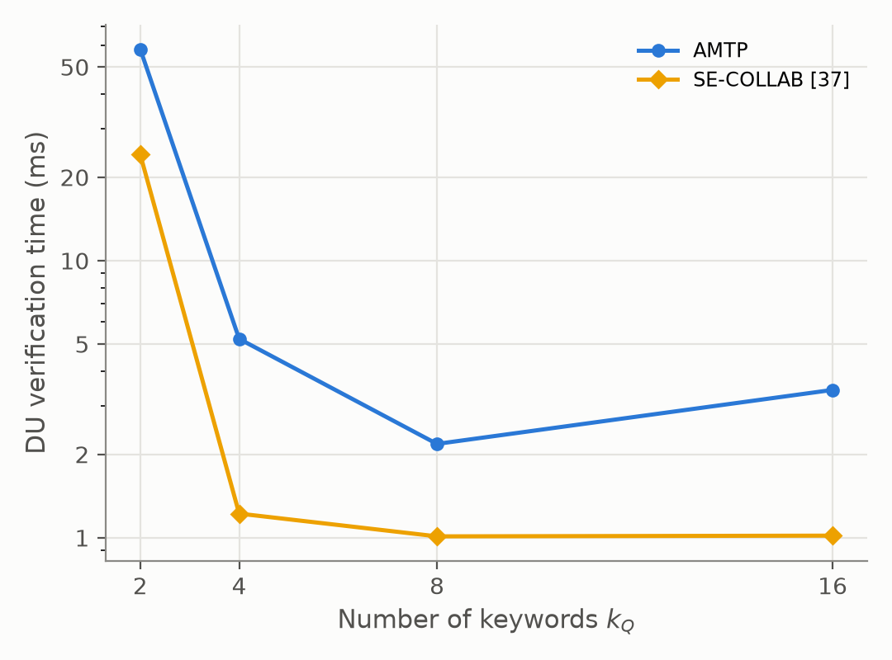

Data: `data/p32_x_search_verify_w8 search_multi shape=AND_of_OR (4 domains)`. SE-COLLAB only (multi-domain Boolean)

- **vs SE-COLLAB [37]:** SE-COLLAB [37] better at kQ = 2, 4, 8, 16 (1.72–3.27×)
- AMTP: 1.74–4.92 ms over kQ = 2…16

### `e1_multi_OR_of_AND_search` (24 p.: Fig. 4 · 6 p.: Fig. 4)

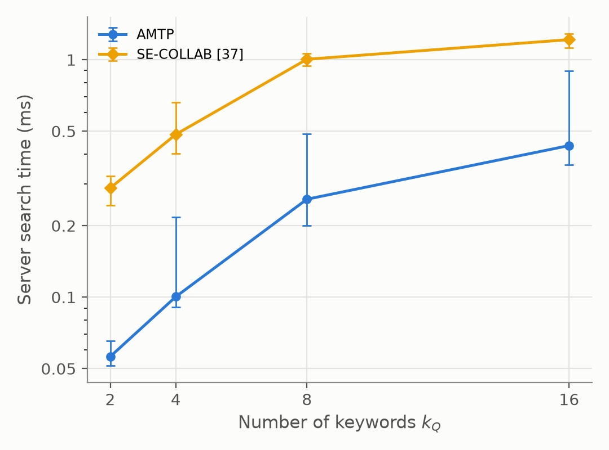

Data: `data/p32_x_search_verify_w8 search_multi shape=OR_of_AND (4 domains)`. server search = posting retrieval + Boolean evaluation, no proof, no fetch; Chen's server does not evaluate the AND (the DU ANDs the decrypted bitmaps); Du = slowest cloud; SE-COLLAB only (multi-domain Boolean)

- **vs SE-COLLAB [37]:** AMTP better at kQ = 2, 4, 8, 16 (2.79–5.13×)
- AMTP: 0.0562–0.435 ms over kQ = 2…16

### `e1_multi_OR_of_AND_e2e`

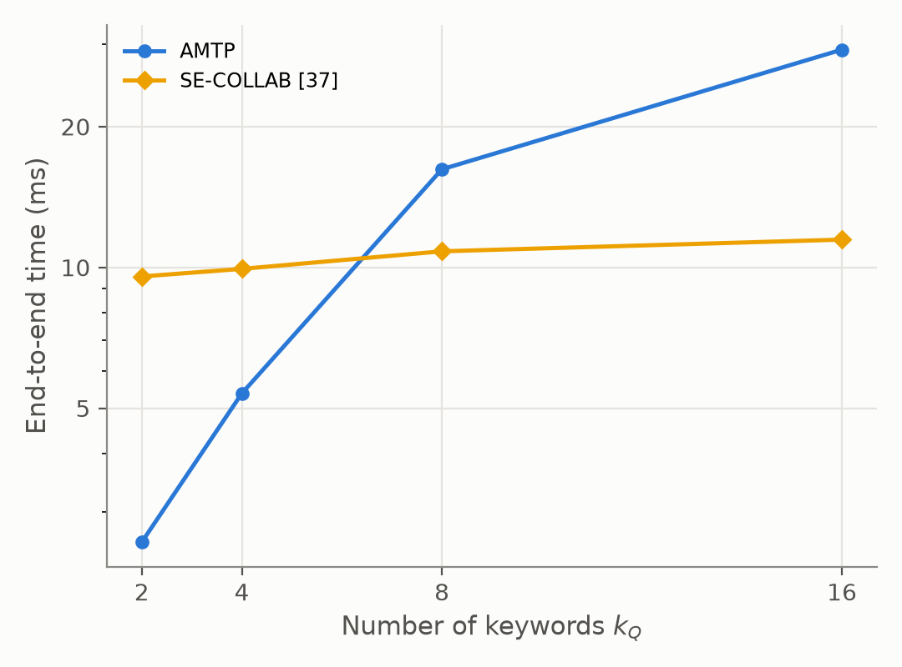

Data: `data/p32_x_search_verify_w8 search_multi shape=OR_of_AND (4 domains)`. SE-COLLAB only (multi-domain Boolean)

- **vs SE-COLLAB [37]:** AMTP better at kQ = 2, 4, 8 (1.17–6.60×); SE-COLLAB [37] better at kQ = 16 (1.68×)
- AMTP: 1.44–18.9 ms over kQ = 2…16

### `e1_multi_OR_of_AND_query_gen`

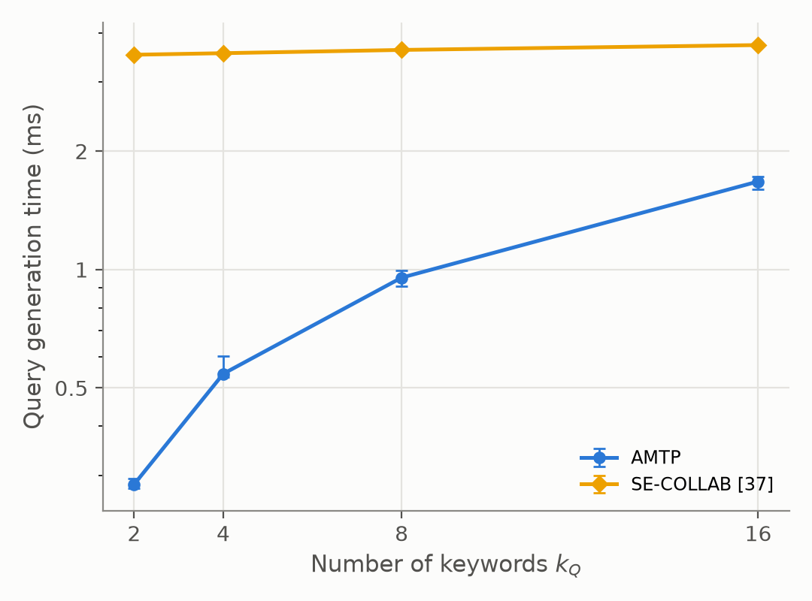

Data: `data/p32_x_search_verify_w8 search_multi shape=OR_of_AND (4 domains)`. SE-COLLAB only (multi-domain Boolean)

- **vs SE-COLLAB [37]:** AMTP better at kQ = 2, 4, 8, 16 (2.22–12.37×)
- AMTP: 0.284–1.68 ms over kQ = 2…16

### `e1_multi_OR_of_AND_server`

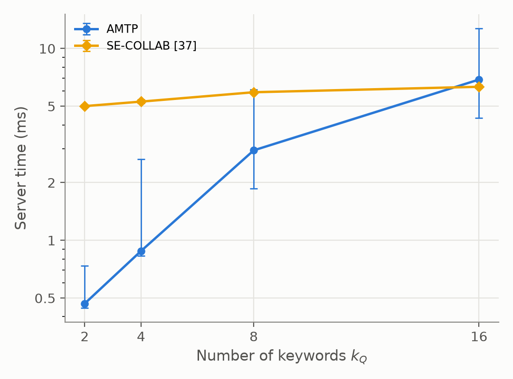

Data: `data/p32_x_search_verify_w8 search_multi shape=OR_of_AND (4 domains)`. SE-COLLAB only (multi-domain Boolean)

- **vs SE-COLLAB [37]:** AMTP better at kQ = 2, 4, 8 (2.01–10.69×); SE-COLLAB [37] better at kQ = 16 (1.09×)
- AMTP: 0.468–6.89 ms over kQ = 2…16

### `e1_multi_OR_of_AND_verify`

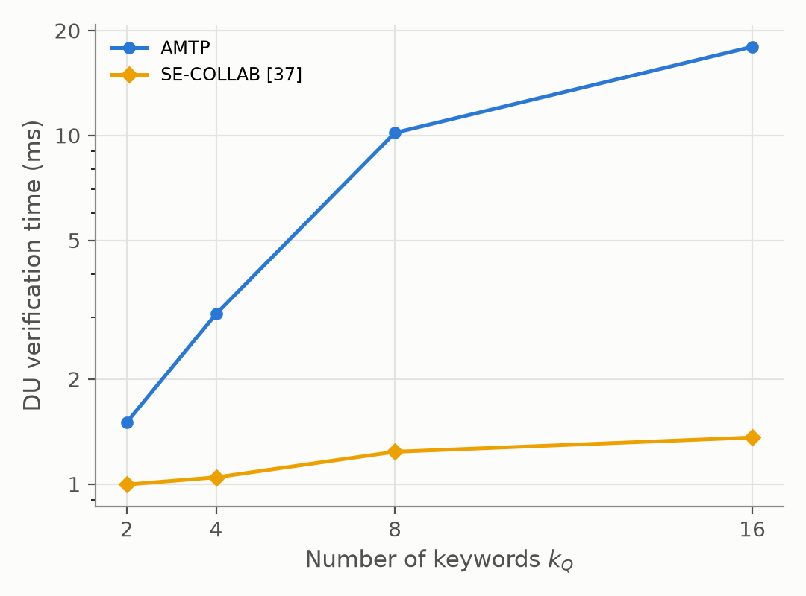

Data: `data/p32_x_search_verify_w8 search_multi shape=OR_of_AND (4 domains)`. SE-COLLAB only (multi-domain Boolean)

- **vs SE-COLLAB [37]:** AMTP better at kQ = 2 (1.45×); SE-COLLAB [37] better at kQ = 4, 8, 16 (1.20–9.67×)
- AMTP: 0.685–10.8 ms over kQ = 2…16

### `e1_domains_search`

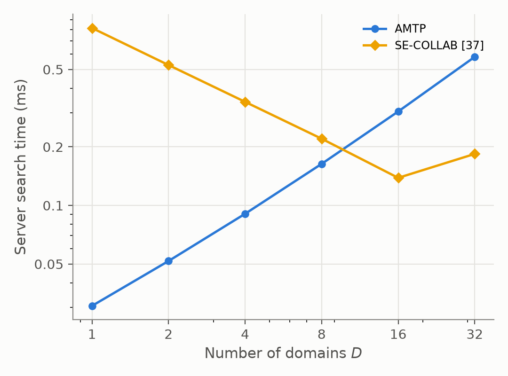

Data: `data/p32_xdomains_w9 domains_scaling`. same files regrouped into D domains

- **vs SE-COLLAB [37]:** AMTP better at D = 1, 2, 4, 8 (1.34–31.12×); SE-COLLAB [37] better at D = 16, 32 (2.18–3.25×)
- AMTP: 0.0265–0.585 ms over D = 1…32

### `e1_domains_e2e`

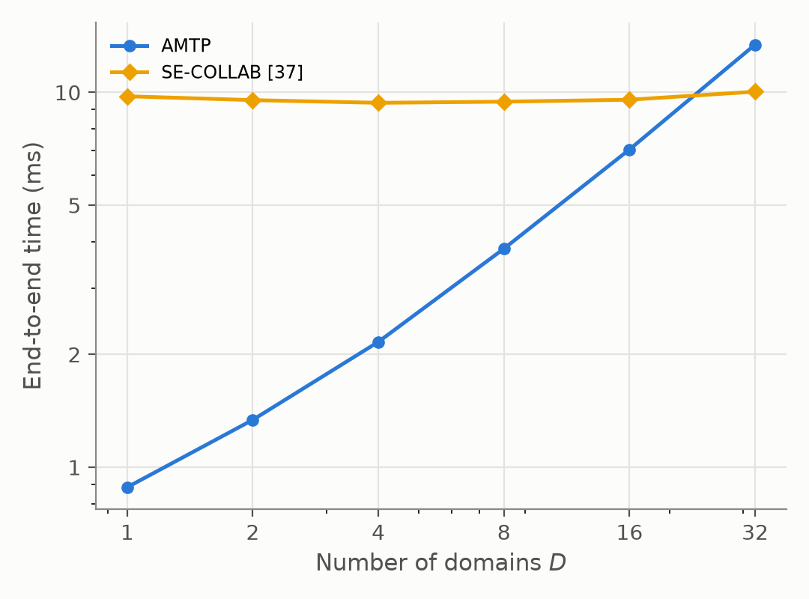

Data: `data/p32_xdomains_w9 domains_scaling`. same files regrouped into D domains

- **vs SE-COLLAB [37]:** AMTP better at D = 1, 2, 4, 8, 16 (1.38–13.23×); SE-COLLAB [37] better at D = 32 (1.32×)
- AMTP: 0.737–13.3 ms over D = 1…32

### `e1_domains_verify`

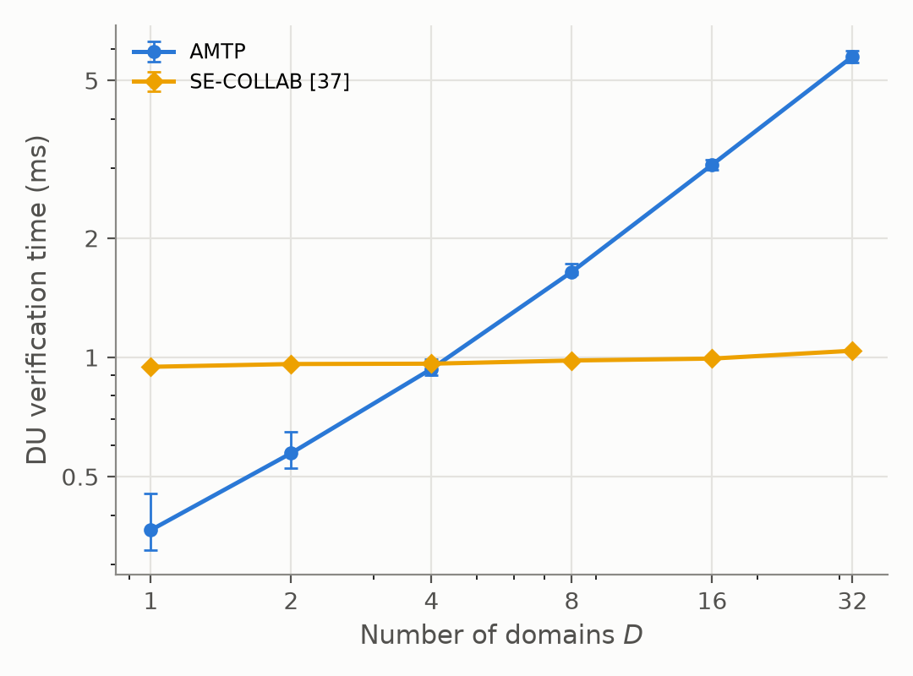

Data: `data/p32_xdomains_w9 domains_scaling`. same files regrouped into D domains

- **vs SE-COLLAB [37]:** AMTP better at D = 1, 2, 4 (1.03–2.58×); SE-COLLAB [37] better at D = 8, 16, 32 (1.67–5.53×)
- AMTP: 0.367–5.75 ms over D = 1…32

### `e1_domains_server`

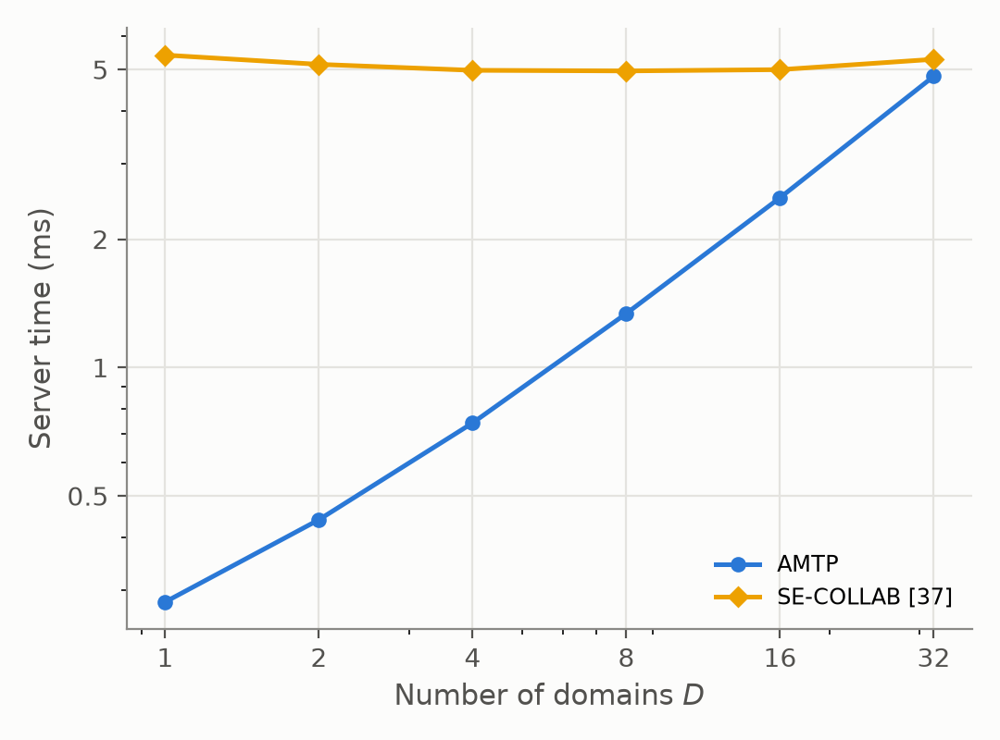

Data: `data/p32_xdomains_w9 domains_scaling`. same files regrouped into D domains

- **vs SE-COLLAB [37]:** AMTP better at D = 1, 2, 4, 8, 16, 32 (1.12–23.56×)
- AMTP: 0.229–4.72 ms over D = 1…32

### `e1_domains_query_gen`

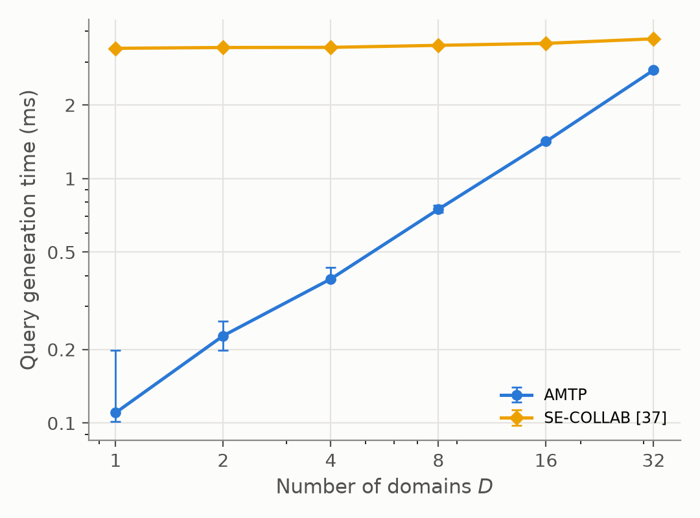

Data: `data/p32_xdomains_w9 domains_scaling`. same files regrouped into D domains

- **vs SE-COLLAB [37]:** AMTP better at D = 1, 2, 4, 8, 16, 32 (1.34–30.93×)
- AMTP: 0.11–2.78 ms over D = 1…32

## Experiment 2: selective proof, verification and tamper detection

### `e2_layout_clustered_proof`

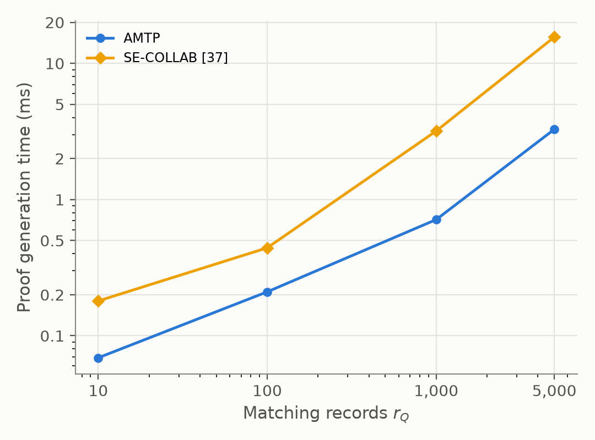

Data: `data/p32_exp2_exp5_w10 exp2_selective_proof layout=clustered`. Chen and Du have no separate proof generation

- **vs SE-COLLAB [37]:** AMTP better at rQ = 10, 100, 1,000, 5,000 (2.10–4.75×)
- AMTP: 0.0689–3.28 ms over rQ = 10…5,000

### `e2_layout_dispersed_proof`

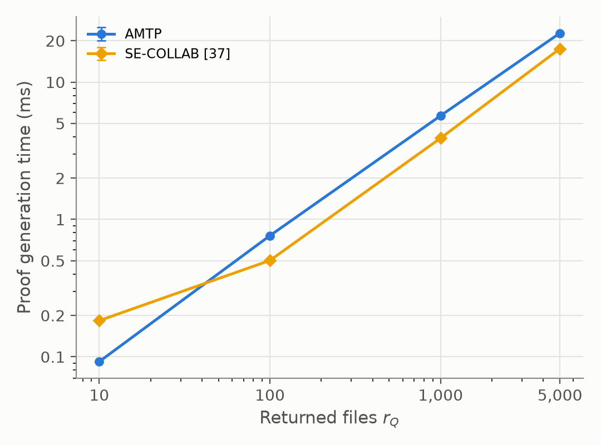

Data: `data/p32_exp2_exp5_w10 exp2_selective_proof layout=dispersed`. Chen and Du have no separate proof generation

- **vs SE-COLLAB [37]:** AMTP better at rQ = 10 (1.99×); SE-COLLAB [37] better at rQ = 100, 1,000, 5,000 (1.30–1.52×)
- AMTP: 0.0922–22.7 ms over rQ = 10…5,000

### `e2_layout_partition_spread_proof`

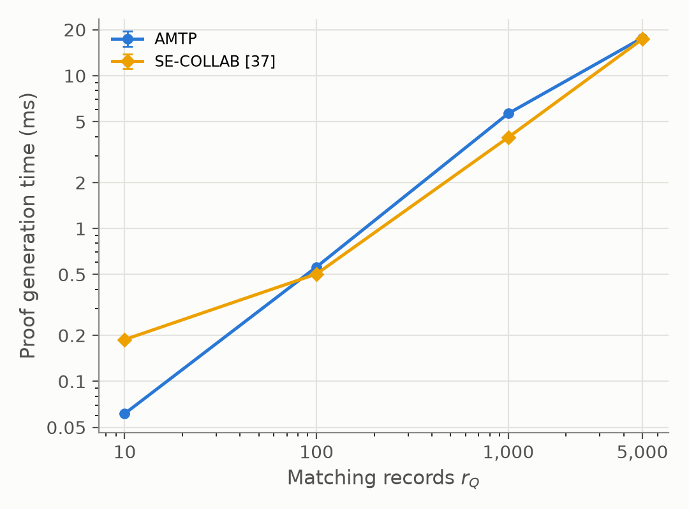

Data: `data/p32_exp2_exp5_w10 exp2_selective_proof layout=partition_spread`. Chen and Du have no separate proof generation

- **vs SE-COLLAB [37]:** AMTP better at rQ = 10 (3.05×); SE-COLLAB [37] better at rQ = 100, 1,000 (1.11–1.43×); tie at rQ = 5,000
- AMTP: 0.0614–17.7 ms over rQ = 10…5,000

### `e2_layouts_proof`

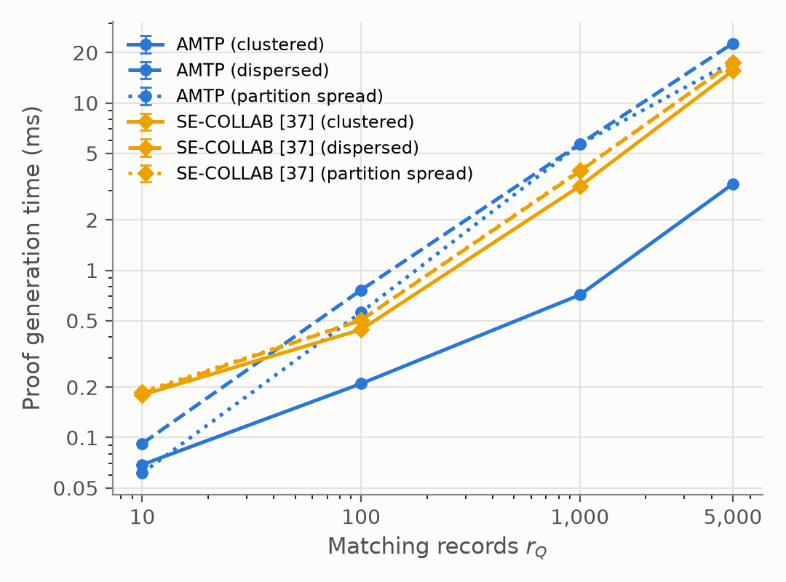

Data: `data/p32_exp2_exp5_w10 exp2_selective_proof`. clustered = few partitions, dispersed = many, partition spread = one record per partition

- **AMTP (clustered) vs SE-COLLAB [37] (clustered):** AMTP (clustered) better at rQ = 10, 100, 1,000, 5,000 (2.10–4.75×)
- **AMTP (dispersed) vs SE-COLLAB [37] (dispersed):** AMTP (dispersed) better at rQ = 10 (1.99×); SE-COLLAB [37] (dispersed) better at rQ = 100, 1,000, 5,000 (1.30–1.52×)
- **AMTP (partition spread) vs SE-COLLAB [37] (partition spread):** AMTP (partition spread) better at rQ = 10 (3.05×); SE-COLLAB [37] (partition spread) better at rQ = 100, 1,000 (1.11–1.43×); tie at rQ = 5,000
- AMTP (clustered): 0.0689–3.28 ms over rQ = 10…5,000
- AMTP (dispersed): 0.0922–22.7 ms over rQ = 10…5,000
- AMTP (partition spread): 0.0614–17.7 ms over rQ = 10…5,000

### `e2_layout_clustered_verify`

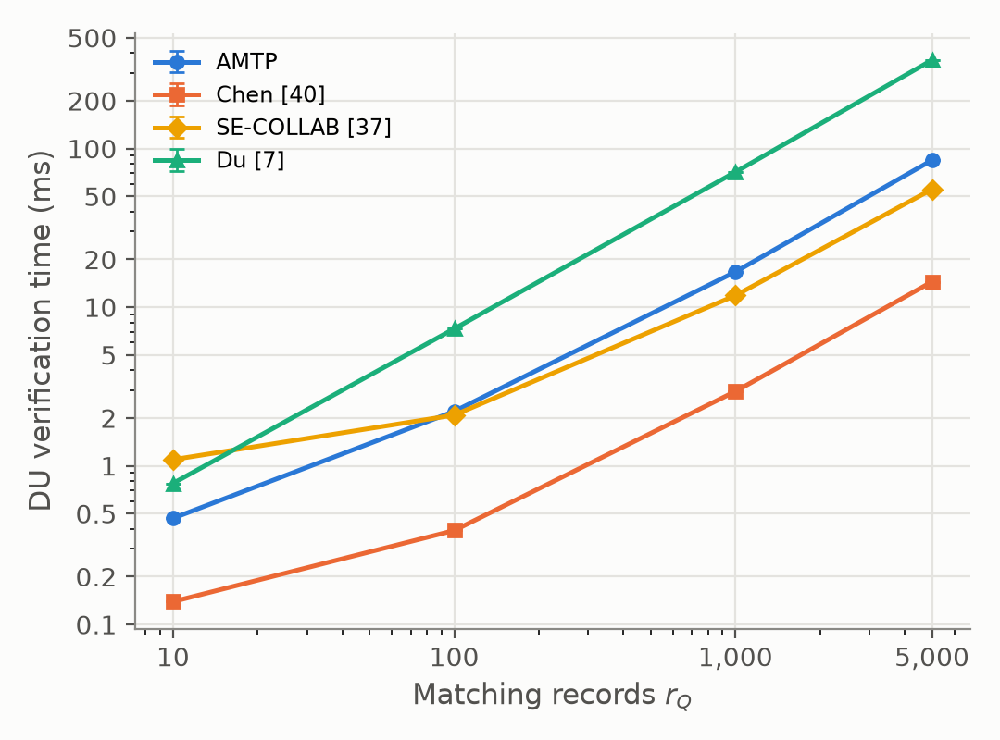

Data: `data/p32_exp2_exp5_w10 exp2_selective_proof layout=clustered`

- **vs Chen [40]:** Chen [40] better at rQ = 10, 100, 1,000, 5,000 (3.35–5.84×)
- **vs SE-COLLAB [37]:** AMTP better at rQ = 10 (2.34×); SE-COLLAB [37] better at rQ = 100, 1,000, 5,000 (1.06–1.53×)
- **vs Du [7]:** AMTP better at rQ = 10, 100, 1,000, 5,000 (1.66–4.28×)
- AMTP: 0.467–84.4 ms over rQ = 10…5,000

### `e2_layout_dispersed_verify`

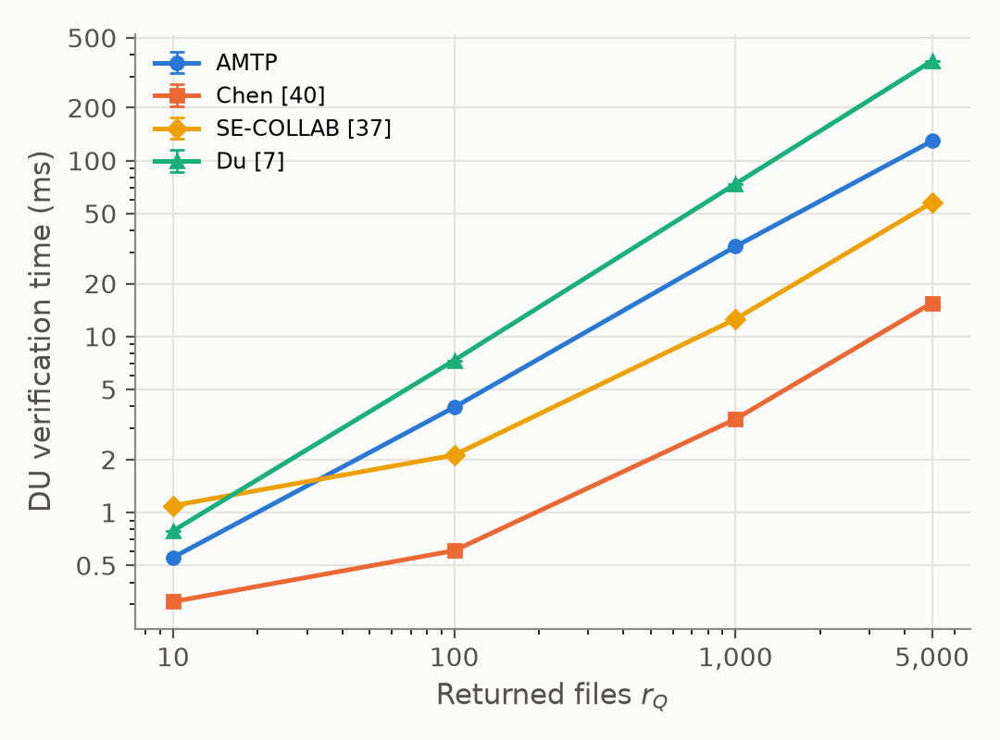

Data: `data/p32_exp2_exp5_w10 exp2_selective_proof layout=dispersed`

- **vs Chen [40]:** Chen [40] better at rQ = 10, 100, 1,000, 5,000 (1.78–9.58×)
- **vs SE-COLLAB [37]:** AMTP better at rQ = 10 (1.97×); SE-COLLAB [37] better at rQ = 100, 1,000, 5,000 (1.87–2.59×)
- **vs Du [7]:** AMTP better at rQ = 10, 100, 1,000, 5,000 (1.42–2.85×)
- AMTP: 0.554–129 ms over rQ = 10…5,000

### `e2_layout_partition_spread_verify`

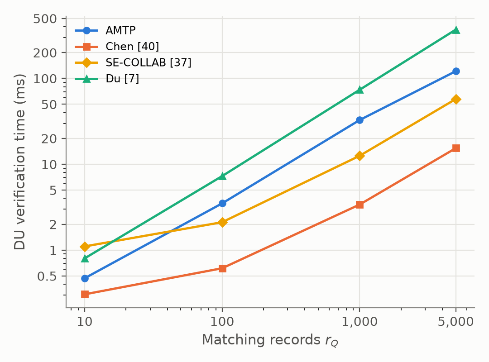

Data: `data/p32_exp2_exp5_w10 exp2_selective_proof layout=partition_spread`

- **vs Chen [40]:** Chen [40] better at rQ = 10, 100, 1,000, 5,000 (1.54–9.65×)
- **vs SE-COLLAB [37]:** AMTP better at rQ = 10 (2.35×); SE-COLLAB [37] better at rQ = 100, 1,000, 5,000 (1.66–2.61×)
- **vs Du [7]:** AMTP better at rQ = 10, 100, 1,000, 5,000 (1.70–3.05×)
- AMTP: 0.47–121 ms over rQ = 10…5,000

### `e2_layouts_verify`

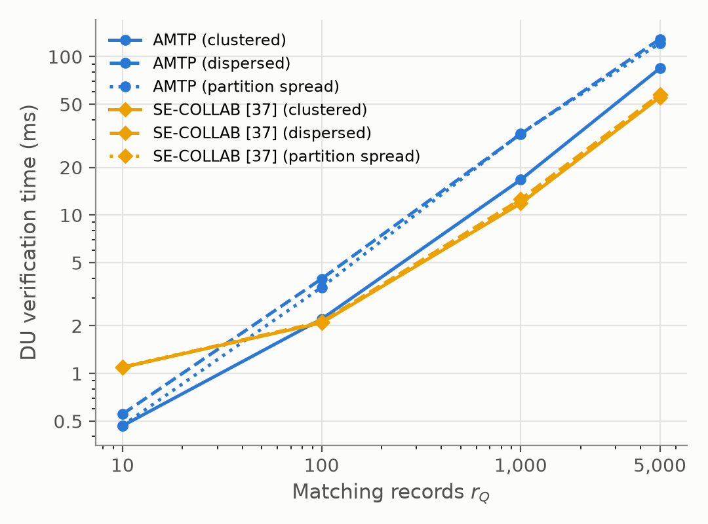

Data: `data/p32_exp2_exp5_w10 exp2_selective_proof`. clustered = few partitions, dispersed = many, partition spread = one record per partition

- **AMTP (clustered) vs SE-COLLAB [37] (clustered):** AMTP (clustered) better at rQ = 10 (2.34×); SE-COLLAB [37] (clustered) better at rQ = 100, 1,000, 5,000 (1.06–1.53×)
- **AMTP (dispersed) vs SE-COLLAB [37] (dispersed):** AMTP (dispersed) better at rQ = 10 (1.97×); SE-COLLAB [37] (dispersed) better at rQ = 100, 1,000, 5,000 (1.87–2.59×)
- **AMTP (partition spread) vs SE-COLLAB [37] (partition spread):** AMTP (partition spread) better at rQ = 10 (2.35×); SE-COLLAB [37] (partition spread) better at rQ = 100, 1,000, 5,000 (1.66–2.61×)
- AMTP (clustered): 0.467–84.4 ms over rQ = 10…5,000
- AMTP (dispersed): 0.554–129 ms over rQ = 10…5,000
- AMTP (partition spread): 0.47–121 ms over rQ = 10…5,000

### `e2_layout_clustered_proof_kb`

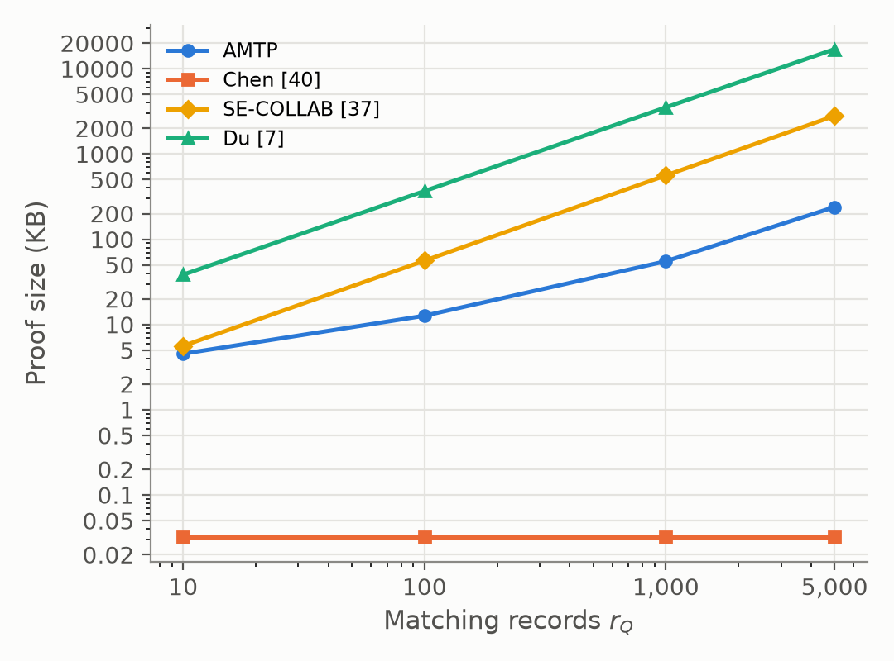

Data: `data/p32_exp2_exp5_w10 exp2_selective_proof layout=clustered`

- **vs Chen [40]:** Chen [40] better at rQ = 10, 100, 1,000, 5,000 (142.00–7462.00×)
- **vs SE-COLLAB [37]:** AMTP better at rQ = 10, 100, 1,000, 5,000 (1.23–11.75×)
- **vs Du [7]:** AMTP better at rQ = 10, 100, 1,000, 5,000 (8.45–71.10×)
- AMTP: 4.54–239 KB over rQ = 10…5,000

### `e2_layout_dispersed_proof_kb`

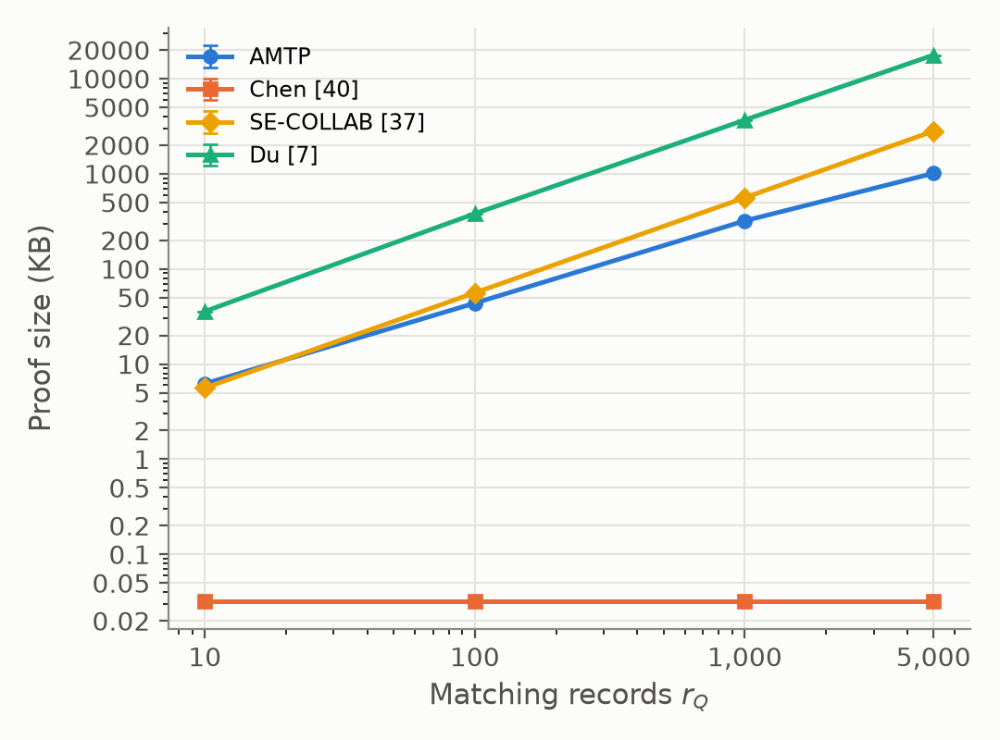

Data: `data/p32_exp2_exp5_w10 exp2_selective_proof layout=dispersed`

- **vs Chen [40]:** Chen [40] better at rQ = 10, 100, 1,000, 5,000 (194.00–31612.50×)
- **vs SE-COLLAB [37]:** AMTP better at rQ = 100, 1,000, 5,000 (1.28–2.77×); SE-COLLAB [37] better at rQ = 10 (1.11×)
- **vs Du [7]:** AMTP better at rQ = 10, 100, 1,000, 5,000 (5.76–17.49×)
- AMTP: 6.21–1,012 KB over rQ = 10…5,000

### `e2_layout_partition_spread_proof_kb`

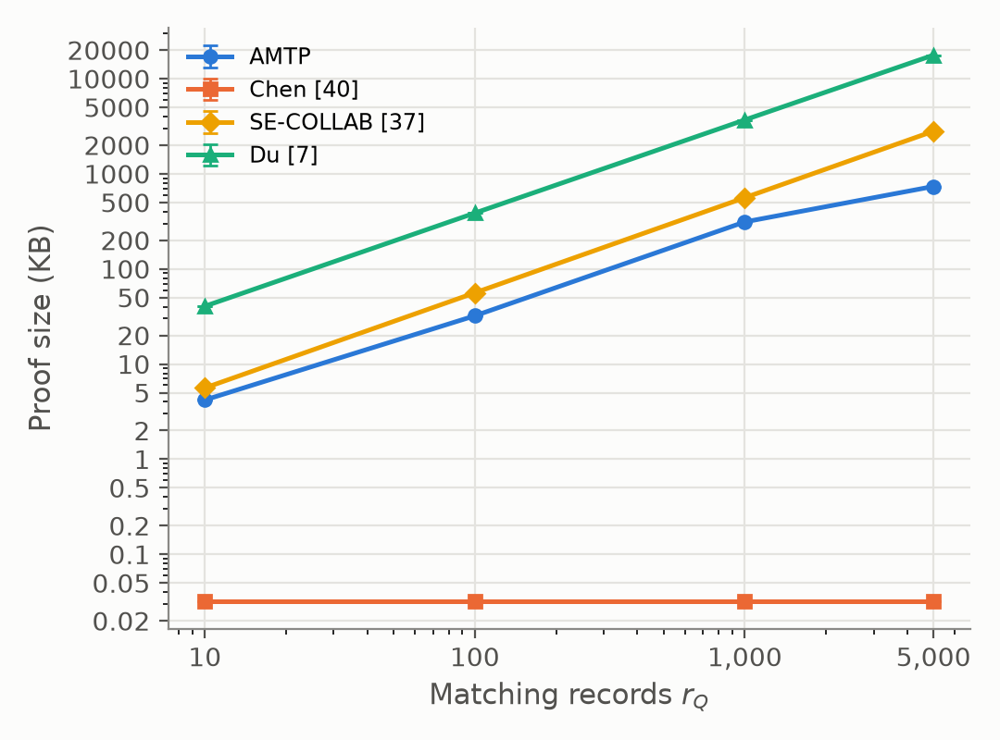

Data: `data/p32_exp2_exp5_w10 exp2_selective_proof layout=partition_spread`

- **vs Chen [40]:** Chen [40] better at rQ = 10, 100, 1,000, 5,000 (131.00–23021.50×)
- **vs SE-COLLAB [37]:** AMTP better at rQ = 10, 100, 1,000, 5,000 (1.34–3.81×)
- **vs Du [7]:** AMTP better at rQ = 10, 100, 1,000, 5,000 (9.68–24.03×)
- AMTP: 4.19–737 KB over rQ = 10…5,000

### `e2_layouts_proof_kb` (extra candidate, in neither version yet)

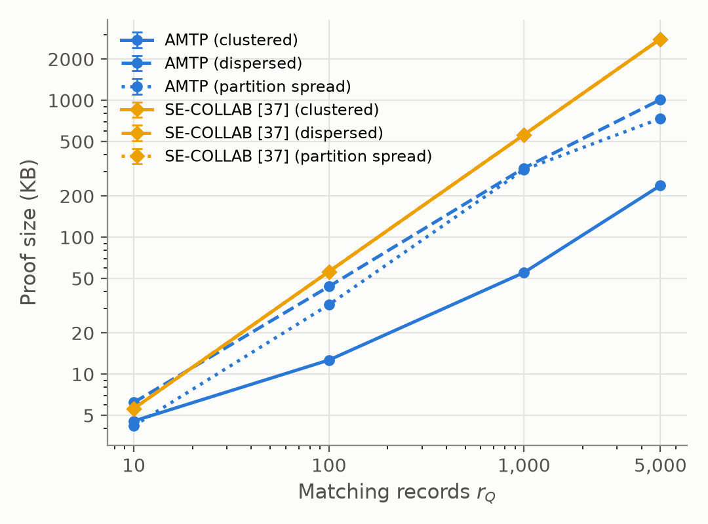

Data: `data/p32_exp2_exp5_w10 exp2_selective_proof`. clustered = few partitions, dispersed = many, partition spread = one record per partition

- **AMTP (clustered) vs SE-COLLAB [37] (clustered):** AMTP (clustered) better at rQ = 10, 100, 1,000, 5,000 (1.23–11.75×)
- **AMTP (dispersed) vs SE-COLLAB [37] (dispersed):** AMTP (dispersed) better at rQ = 100, 1,000, 5,000 (1.28–2.77×); SE-COLLAB [37] (dispersed) better at rQ = 10 (1.11×)
- **AMTP (partition spread) vs SE-COLLAB [37] (partition spread):** AMTP (partition spread) better at rQ = 10, 100, 1,000, 5,000 (1.34–3.81×)
- AMTP (clustered): 4.54–239 KB over rQ = 10…5,000
- AMTP (dispersed): 6.21–1,012 KB over rQ = 10…5,000
- AMTP (partition spread): 4.19–737 KB over rQ = 10…5,000

### `e2_layout_clustered_server`

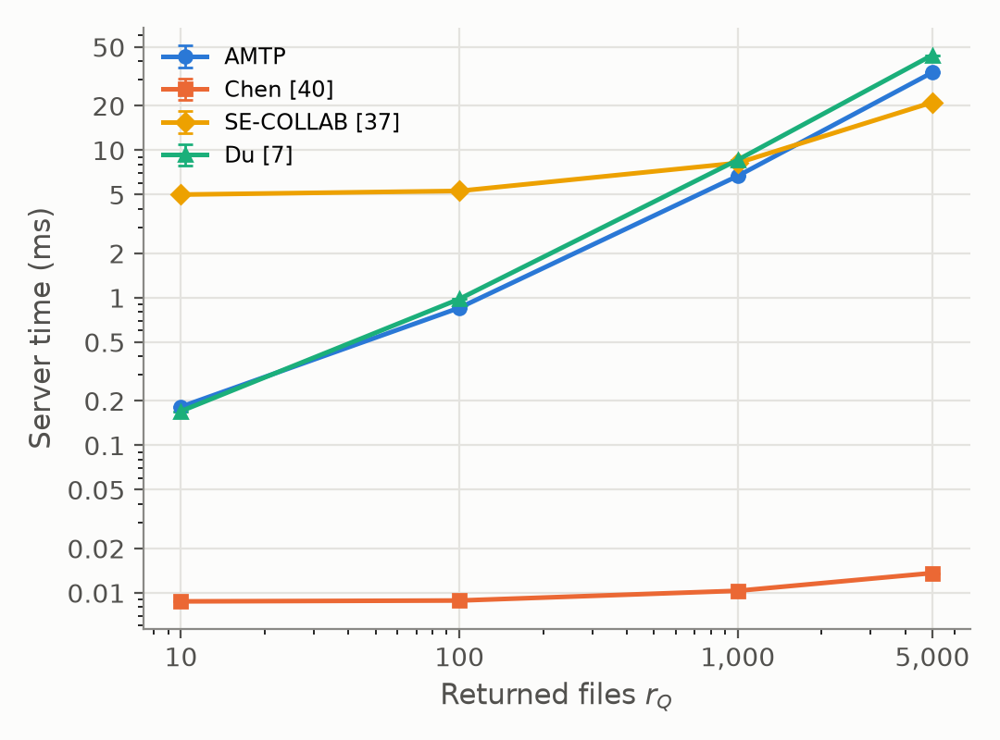

Data: `data/p32_exp2_exp5_w10 exp2_selective_proof layout=clustered`

- **vs Chen [40]:** Chen [40] better at rQ = 10, 100, 1,000, 5,000 (20.84–2471.31×)
- **vs SE-COLLAB [37]:** AMTP better at rQ = 10, 100, 1,000 (1.22–27.42×); SE-COLLAB [37] better at rQ = 5,000 (1.60×)
- **vs Du [7]:** AMTP better at rQ = 100, 1,000, 5,000 (1.15–1.31×); Du [7] better at rQ = 10 (1.07×)
- AMTP: 0.183–33.7 ms over rQ = 10…5,000

### `e2_layout_dispersed_server`

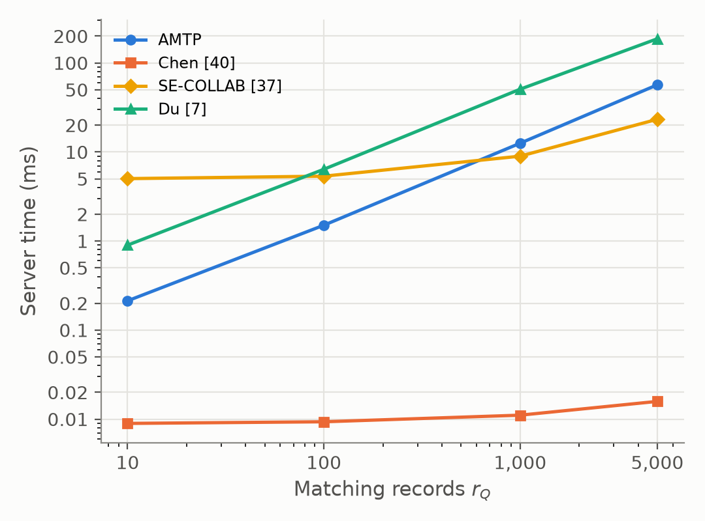

Data: `data/p32_exp2_exp5_w10 exp2_selective_proof layout=dispersed`

- **vs Chen [40]:** Chen [40] better at rQ = 10, 100, 1,000, 5,000 (23.81–3586.68×)
- **vs SE-COLLAB [37]:** AMTP better at rQ = 10, 100 (3.55–23.54×); SE-COLLAB [37] better at rQ = 1,000, 5,000 (1.40–2.44×)
- **vs Du [7]:** AMTP better at rQ = 10, 100, 1,000, 5,000 (3.29–4.25×)
- AMTP: 0.213–56.8 ms over rQ = 10…5,000

### `e2_layout_partition_spread_server`

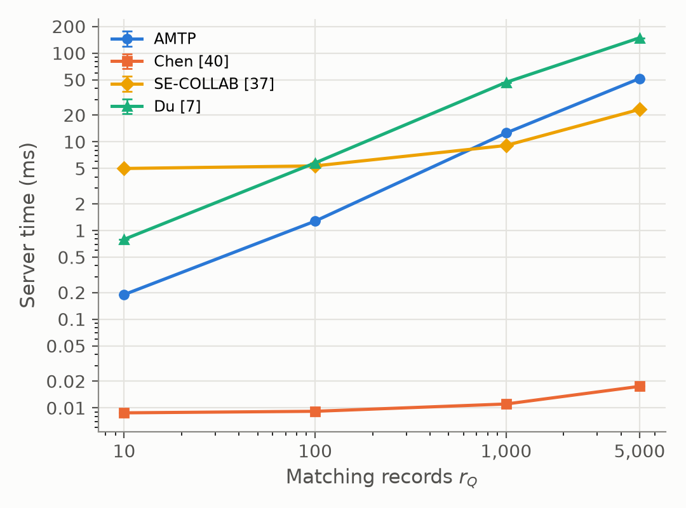

Data: `data/p32_exp2_exp5_w10 exp2_selective_proof layout=partition_spread`

- **vs Chen [40]:** Chen [40] better at rQ = 10, 100, 1,000, 5,000 (21.55–2957.09×)
- **vs SE-COLLAB [37]:** AMTP better at rQ = 10, 100 (4.19–26.41×); SE-COLLAB [37] better at rQ = 1,000, 5,000 (1.38–2.23×)
- **vs Du [7]:** AMTP better at rQ = 10, 100, 1,000, 5,000 (2.88–4.53×)
- AMTP: 0.189–51.6 ms over rQ = 10…5,000

### `e2_layouts_server`

Data: `data/p32_exp2_exp5_w10 exp2_selective_proof`. clustered = few partitions, dispersed = many, partition spread = one record per partition

- **AMTP (clustered) vs SE-COLLAB [37] (clustered):** AMTP (clustered) better at rQ = 10, 100, 1,000 (1.22–27.42×); SE-COLLAB [37] (clustered) better at rQ = 5,000 (1.60×)
- **AMTP (dispersed) vs SE-COLLAB [37] (dispersed):** AMTP (dispersed) better at rQ = 10, 100 (3.55–23.54×); SE-COLLAB [37] (dispersed) better at rQ = 1,000, 5,000 (1.40–2.44×)
- **AMTP (partition spread) vs SE-COLLAB [37] (partition spread):** AMTP (partition spread) better at rQ = 10, 100 (4.19–26.41×); SE-COLLAB [37] (partition spread) better at rQ = 1,000, 5,000 (1.38–2.23×)
- AMTP (clustered): 0.183–33.7 ms over rQ = 10…5,000
- AMTP (dispersed): 0.213–56.8 ms over rQ = 10…5,000
- AMTP (partition spread): 0.189–51.6 ms over rQ = 10…5,000

### `e2_layout_clustered_e2e`

Data: `data/p32_exp2_exp5_w10 exp2_selective_proof layout=clustered`

- **vs Chen [40]:** Chen [40] better at rQ = 10, 100, 1,000, 5,000 (2.25–7.91×)
- **vs SE-COLLAB [37]:** AMTP better at rQ = 10, 100 (3.52–14.01×); SE-COLLAB [37] better at rQ = 5,000 (1.48×); tie at rQ = 1,000
- **vs Du [7]:** AMTP better at rQ = 10, 100, 1,000, 5,000 (1.40–3.43×)
- AMTP: 0.687–118 ms over rQ = 10…5,000

### `e2_layout_dispersed_e2e`

Data: `data/p32_exp2_exp5_w10 exp2_selective_proof layout=dispersed`

- **vs Chen [40]:** Chen [40] better at rQ = 10, 100, 1,000, 5,000 (1.23–11.15×)
- **vs SE-COLLAB [37]:** AMTP better at rQ = 10, 100 (1.99–11.98×); SE-COLLAB [37] better at rQ = 1,000, 5,000 (1.79–2.20×)
- **vs Du [7]:** AMTP better at rQ = 10, 100, 1,000, 5,000 (2.12–2.98×)
- AMTP: 0.804–186 ms over rQ = 10…5,000

### `e2_layout_partition_spread_e2e`

Data: `data/p32_exp2_exp5_w10 exp2_selective_proof layout=partition_spread`

- **vs Chen [40]:** Chen [40] better at rQ = 10, 100, 1,000, 5,000 (1.08–11.20×)
- **vs SE-COLLAB [37]:** AMTP better at rQ = 10, 100 (2.28–13.82×); SE-COLLAB [37] better at rQ = 1,000, 5,000 (1.80–2.05×)
- **vs Du [7]:** AMTP better at rQ = 10, 100, 1,000, 5,000 (2.33–3.00×)
- AMTP: 0.695–173 ms over rQ = 10…5,000

### `e2_layouts_e2e`

Data: `data/p32_exp2_exp5_w10 exp2_selective_proof`. clustered = few partitions, dispersed = many, partition spread = one record per partition

- **AMTP (clustered) vs SE-COLLAB [37] (clustered):** AMTP (clustered) better at rQ = 10, 100 (3.52–14.01×); SE-COLLAB [37] (clustered) better at rQ = 5,000 (1.48×); tie at rQ = 1,000
- **AMTP (dispersed) vs SE-COLLAB [37] (dispersed):** AMTP (dispersed) better at rQ = 10, 100 (1.99–11.98×); SE-COLLAB [37] (dispersed) better at rQ = 1,000, 5,000 (1.79–2.20×)
- **AMTP (partition spread) vs SE-COLLAB [37] (partition spread):** AMTP (partition spread) better at rQ = 10, 100 (2.28–13.82×); SE-COLLAB [37] (partition spread) better at rQ = 1,000, 5,000 (1.80–2.05×)
- AMTP (clustered): 0.687–118 ms over rQ = 10…5,000
- AMTP (dispersed): 0.804–186 ms over rQ = 10…5,000
- AMTP (partition spread): 0.695–173 ms over rQ = 10…5,000

### `e2_single_verify_verify` (24 p.: Fig. 5(a) · 6 p.: Fig. 5)

Data: `data/p32_ex2_verify1_tamper_w7 verify_single`

- **vs Chen [40]:** Chen [40] better at rQ = 10, 100, 1,000, 10,000 (1.87–9.24×)
- **vs SE-COLLAB [37]:** AMTP better at rQ = 10 (1.99×); SE-COLLAB [37] better at rQ = 100, 1,000, 10,000 (1.83–2.50×)
- **vs Du [7]:** AMTP better at rQ = 10, 100, 1,000, 10,000 (1.43–2.57×)
- AMTP: 0.521–69.8 ms over rQ = 10…10,000

### `e2_single_verify_proof_kb`

Data: `data/p32_ex2_verify1_tamper_w7 verify_single`

- **vs Chen [40]:** Chen [40] better at rQ = 10, 100, 1,000, 10,000 (193.00–17891.88×)
- **vs SE-COLLAB [37]:** AMTP better at rQ = 100, 1,000, 10,000 (1.32–2.50×); SE-COLLAB [37] better at rQ = 10 (1.10×)
- **vs Du [7]:** AMTP better at rQ = 10, 100, 1,000, 10,000 (5.64–15.21×)
- AMTP: 6.18–573 KB over rQ = 10…10,000

### `e2_single_verify_e2e`

Data: `data/p32_ex2_verify1_tamper_w7 verify_single`

- **vs Chen [40]:** Chen [40] better at rQ = 10, 100, 1,000, 10,000 (1.31–11.57×)
- **vs SE-COLLAB [37]:** AMTP better at rQ = 10, 100 (2.01–11.96×); SE-COLLAB [37] better at rQ = 1,000, 10,000 (1.77–2.18×)
- **vs Du [7]:** AMTP better at rQ = 10, 100, 1,000, 10,000 (1.97–2.74×)
- AMTP: 0.761–101 ms over rQ = 10…10,000

### `e2_single_verify_search`

Data: `data/p32_ex2_verify1_tamper_w7 verify_single`. server search = posting retrieval + Boolean evaluation, no proof, no fetch; Chen's server does not evaluate the AND (the DU ANDs the decrypted bitmaps); Du = slowest cloud

- **vs Chen [40]:** Chen [40] better at rQ = 10, 100, 1,000, 10,000 (1.14–84.63×)
- **vs SE-COLLAB [37]:** AMTP better at rQ = 10, 100 (6.19–20.77×); SE-COLLAB [37] better at rQ = 1,000, 10,000 (1.50–5.24×)
- **vs Du [7]:** AMTP better at rQ = 10, 100, 1,000, 10,000 (74.42–150.12×)
- AMTP: 0.00972–1.20 ms over rQ = 10…10,000

### `e2_single_verify_server`

Data: `data/p32_ex2_verify1_tamper_w7 verify_single`

- **vs Chen [40]:** Chen [40] better at rQ = 10, 100, 1,000, 10,000 (24.21–2176.90×)
- **vs SE-COLLAB [37]:** AMTP better at rQ = 10, 100 (3.55–22.90×); SE-COLLAB [37] better at rQ = 1,000, 10,000 (1.48–2.19×)
- **vs Du [7]:** AMTP better at rQ = 10, 100, 1,000, 10,000 (3.16–3.82×)
- AMTP: 0.206–30.8 ms over rQ = 10…10,000

### `e2_tamper_modify_detection`

Data: `data/p32_ex2_verify1_tamper_w7 tamper_detection`. a scheme without this attack model has no line (Chen: modify / old version N/A)

- **vs SE-COLLAB [37]:** tie at t = 5, 10, 20, 40, 100, 1,000
- **vs Du [7]:** tie at t = 5, 10, 20, 40, 100, 1,000
- AMTP: 100–100 % detected over t = 5…1,000

### `e2_tamper_modify_verify`

Data: `data/p32_ex2_verify1_tamper_w7 tamper_detection`. time until the DU rejects

- **vs SE-COLLAB [37]:** SE-COLLAB [37] better at t = 5, 10, 20, 40, 100, 1,000 (1.34–1.54×)
- **vs Du [7]:** AMTP better at t = 5, 10, 20, 40, 100, 1,000 (3.94–4.57×)
- AMTP: 31.6–36.5 ms over t = 5…1,000

### `e2_tamper_hide_detection`

Data: `data/p32_ex2_verify1_tamper_w7 tamper_detection`. a scheme without this attack model has no line (Chen: modify / old version N/A)

- **vs Chen [40]:** tie at t = 5, 10, 20, 40, 100, 1,000
- **vs SE-COLLAB [37]:** AMTP better at t = 5, 10, 20, 40, 100, 1,000 (other side 0)
- **vs Du [7]:** tie at t = 5, 10, 20, 40, 100, 1,000
- AMTP: 100–100 % detected over t = 5…1,000

### `e2_tamper_hide_verify`

Data: `data/p32_ex2_verify1_tamper_w7 tamper_detection`. time until the DU rejects

- **vs Chen [40]:** Chen [40] better at t = 5, 10, 20, 40, 100, 1,000 (4.92–8.80×)
- **vs SE-COLLAB [37]:** SE-COLLAB [37] better at t = 5, 10, 20, 40, 100, 1,000 (1.32–2.40×)
- **vs Du [7]:** AMTP better at t = 5, 10, 20, 40, 100, 1,000 (4.30–4.68×)
- AMTP: 30.6–31.4 ms over t = 5…1,000

### `e2_tamper_inject_detection`

Data: `data/p32_ex2_verify1_tamper_w7 tamper_detection`. a scheme without this attack model has no line (Chen: modify / old version N/A)

- **vs Chen [40]:** tie at t = 5, 10, 20, 40, 100, 1,000
- **vs SE-COLLAB [37]:** AMTP better at t = 5, 10, 20, 40, 100, 1,000 (other side 0)
- **vs Du [7]:** AMTP better at t = 5, 10, 20, 40, 100, 1,000 (other side 0)
- AMTP: 100–100 % detected over t = 5…1,000

### `e2_tamper_inject_verify`

Data: `data/p32_ex2_verify1_tamper_w7 tamper_detection`. time until the DU rejects

- **vs Chen [40]:** Chen [40] better at t = 5, 10, 20, 40, 100, 1,000 (3.40–4.91×)
- **vs SE-COLLAB [37]:** AMTP better at t = 1,000 (1.10×); SE-COLLAB [37] better at t = 5, 10, 20, 40, 100 (1.25–1.32×)
- **vs Du [7]:** AMTP better at t = 5, 10, 20, 40, 100, 1,000 (4.60–4.84×)
- AMTP: 31.1–31.7 ms over t = 5…1,000

### `e2_tamper_old_version_detection`

Data: `data/p32_ex2_verify1_tamper_w7 tamper_detection`. a scheme without this attack model has no line (Chen: modify / old version N/A)

- **vs SE-COLLAB [37]:** tie at t = 5, 10, 20, 40, 100, 1,000
- **vs Du [7]:** tie at t = 5, 10, 20, 40, 100, 1,000
- AMTP: 100–100 % detected over t = 5…1,000

### `e2_tamper_old_version_verify`

Data: `data/p32_ex2_verify1_tamper_w7 tamper_detection`. time until the DU rejects

- **vs SE-COLLAB [37]:** SE-COLLAB [37] better at t = 5, 10, 20, 40, 100, 1,000 (1.31–1.53×)
- **vs Du [7]:** AMTP better at t = 5, 10, 20, 40, 100, 1,000 (4.00–4.61×)
- AMTP: 31.3–36.3 ms over t = 5…1,000

### `e2_tamper_attack_types` (24 p.: Fig. 5(c) · 6 p.: Table III (as a table))

Data: `data/p32_ex2_verify1_tamper_w7 tamper_detection`. attack types (modified, hidden, injected, old version) detected in every run; Chen has no modified / old-version attack model

- **vs Chen [40]:** AMTP better at t = 5, 10, 20, 40, 100, 1,000 (2.00×)
- **vs SE-COLLAB [37]:** AMTP better at t = 5, 10, 20, 40, 100, 1,000 (2.00×)
- **vs Du [7]:** AMTP better at t = 5, 10, 20, 40, 100, 1,000 (1.33×)
- AMTP: 4.00–4.00 attack types of 4 over t = 5…1,000

### `e2_tamper_false_alarms`

- **vs Chen [40]:** tie at t = honest
- **vs SE-COLLAB [37]:** tie at t = honest
- **vs Du [7]:** tie at t = honest
- AMTP: 0–0 % false alarms

### `e2_multi_verify_verify` (24 p.: Fig. 5(b))

Data: `data/p32_x_search_verify_w8 verify_multi`. SE-COLLAB only (multi domain)

- **vs SE-COLLAB [37]:** AMTP better at rQ = 10 (1.30×); SE-COLLAB [37] better at rQ = 100, 1,000, 10,000 (2.00–2.66×)
- AMTP: 0.841–258 ms over rQ = 10…10,000

### `e2_multi_verify_proof_kb`

Data: `data/p32_x_search_verify_w8 verify_multi`. SE-COLLAB only (multi domain)

- **vs SE-COLLAB [37]:** AMTP better at rQ = 100, 1,000, 10,000 (1.13–2.43×); SE-COLLAB [37] better at rQ = 10 (1.62×)
- AMTP: 9.10–2,184 KB over rQ = 10…10,000

### `e2_multi_verify_e2e`

Data: `data/p32_x_search_verify_w8 verify_multi`. SE-COLLAB only (multi domain)

- **vs SE-COLLAB [37]:** AMTP better at rQ = 10, 100 (1.82–7.35×); SE-COLLAB [37] better at rQ = 1,000, 10,000 (1.88–2.38×)
- AMTP: 1.38–376 ms over rQ = 10…10,000

### `e2_multi_verify_search`

Data: `data/p32_x_search_verify_w8 verify_multi`. SE-COLLAB only (multi domain)

- **vs SE-COLLAB [37]:** AMTP better at rQ = 10, 100, 1,000 (2.07–22.93×); SE-COLLAB [37] better at rQ = 10,000 (5.84×)
- AMTP: 0.0321–5.34 ms over rQ = 10…10,000

## Experiment 3: dynamic update scalability

### `e3_b_update`

Data: `data/p32_ex3_w10/. exp3_dynamic_update`. AMTP: signed requests (ABS) + CS prepare + DO validation + anchor (local EVM); Chen: token generation + CS apply, no update verification

- **AMTP insert vs Chen [40] insert:** Chen [40] insert better at b = 1, 10, 100, 1,000 (24.57–229.78×)
- **AMTP delete vs Chen [40] delete:** Chen [40] delete better at b = 1, 10, 100, 1,000 (26.95–210.27×)
- AMTP insert: 287–35,039 ms over b = 1…1,000
- AMTP delete: 284–41,066 ms over b = 1…1,000

### `e3_b_per_request`

Data: `data/p32_ex3_w10/. exp3_dynamic_update`. AMTP: signed requests (ABS) + CS prepare + DO validation + anchor (local EVM); Chen: token generation + CS apply, no update verification

- **AMTP insert vs Chen [40] insert:** Chen [40] insert better at b = 1, 10, 100, 1,000 (24.57–229.78×)
- **AMTP delete vs Chen [40] delete:** Chen [40] delete better at b = 1, 10, 100, 1,000 (26.95–210.27×)
- AMTP insert: 35.0–287 ms over b = 1…1,000
- AMTP delete: 41.1–284 ms over b = 1…1,000

### `e3_b_throughput`

Data: `data/p32_ex3_w10/. exp3_dynamic_update`. AMTP: signed requests (ABS) + CS prepare + DO validation + anchor (local EVM); Chen: token generation + CS apply, no update verification

- **AMTP insert vs Chen [40] insert:** Chen [40] insert better at b = 1, 10, 100, 1,000 (24.57–229.78×)
- **AMTP delete vs Chen [40] delete:** Chen [40] delete better at b = 1, 10, 100, 1,000 (26.95–210.27×)
- AMTP insert: 3.49–28.5 requests/s over b = 1…1,000
- AMTP delete: 3.53–24.4 requests/s over b = 1…1,000

### `e3_b_breakdown_insert` (extra candidate, in neither version yet)

Data: `data/p32_ex3_w10/. exp3_dynamic_update`. ABS is part of request / CS prepare / DO validation; posting repair + auth tree are inside CS prepare

- protocol (no anchor): 145–34,896 ms over b = 1…1,000
- CS prepare: 75.9–13,198 ms over b = 1…1,000
- DO validation: 60.0–13,174 ms over b = 1…1,000
- ABS sign + 2 verify: 21.6–21,174 ms over b = 1…1,000
- posting repair: 25.8–3,293 ms over b = 1…1,000
- auth-tree maintenance: 14.2–1,783 ms over b = 1…1,000
- anchor (local EVM): 142–143 ms over b = 1…1,000

### `e3_b_breakdown_delete`

Data: `data/p32_ex3_w10/. exp3_dynamic_update`. ABS is part of request / CS prepare / DO validation; posting repair + auth tree are inside CS prepare

- protocol (no anchor): 141–40,923 ms over b = 1…1,000
- CS prepare: 72.7–19,443 ms over b = 1…1,000
- DO validation: 59.6–13,114 ms over b = 1…1,000
- ABS sign + 2 verify: 21.6–21,169 ms over b = 1…1,000
- posting repair: 23.3–3,252 ms over b = 1…1,000
- auth-tree maintenance: 17.6–8,253 ms over b = 1…1,000
- anchor (local EVM): 142–144 ms over b = 1…1,000

### `e3_n_update`

Data: `data/p32_ex3_w10/update_n exp3_dynamic_update`. AMTP: signed requests (ABS) + CS prepare + DO validation + anchor (local EVM); Chen: token generation + CS apply, no update verification

- **AMTP insert vs Chen [40] insert:** Chen [40] insert better at N = 10,000, 25,000, 50,000, 75,000, 100,000, 125,000 (32.14–64.56×)
- **AMTP delete vs Chen [40] delete:** Chen [40] delete better at N = 10,000, 25,000, 50,000, 75,000, 100,000, 125,000 (33.41–64.44×)
- AMTP insert: 3,501–5,366 ms over N = 10,000…125,000
- AMTP delete: 3,554–5,842 ms over N = 10,000…125,000

### `e3_n_per_request`

Data: `data/p32_ex3_w10/update_n exp3_dynamic_update`. AMTP: signed requests (ABS) + CS prepare + DO validation + anchor (local EVM); Chen: token generation + CS apply, no update verification

- **AMTP insert vs Chen [40] insert:** Chen [40] insert better at N = 10,000, 25,000, 50,000, 75,000, 100,000, 125,000 (32.14–64.56×)
- **AMTP delete vs Chen [40] delete:** Chen [40] delete better at N = 10,000, 25,000, 50,000, 75,000, 100,000, 125,000 (33.41–64.44×)
- AMTP insert: 35.0–53.7 ms over N = 10,000…125,000
- AMTP delete: 35.5–58.4 ms over N = 10,000…125,000

### `e3_n_throughput`

Data: `data/p32_ex3_w10/update_n exp3_dynamic_update`. AMTP: signed requests (ABS) + CS prepare + DO validation + anchor (local EVM); Chen: token generation + CS apply, no update verification

- **AMTP insert vs Chen [40] insert:** Chen [40] insert better at N = 10,000, 25,000, 50,000, 75,000, 100,000, 125,000 (32.14–64.56×)
- **AMTP delete vs Chen [40] delete:** Chen [40] delete better at N = 10,000, 25,000, 50,000, 75,000, 100,000, 125,000 (33.41–64.44×)
- AMTP insert: 18.6–28.6 requests/s over N = 10,000…125,000
- AMTP delete: 17.1–28.1 requests/s over N = 10,000…125,000

### `e3_n_breakdown_insert`

Data: `data/p32_ex3_w10/update_n exp3_dynamic_update`. ABS is part of request / CS prepare / DO validation; posting repair + auth tree are inside CS prepare

- protocol (no anchor): 3,357–5,222 ms over N = 10,000…125,000
- CS prepare: 1,234–2,149 ms over N = 10,000…125,000
- DO validation: 1,274–2,220 ms over N = 10,000…125,000
- ABS sign + 2 verify: 2,114–2,121 ms over N = 10,000…125,000
- posting repair: 301–770 ms over N = 10,000…125,000
- auth-tree maintenance: 123–304 ms over N = 10,000…125,000
- anchor (local EVM): 143–145 ms over N = 10,000…125,000

### `e3_n_breakdown_delete`

Data: `data/p32_ex3_w10/update_n exp3_dynamic_update`. ABS is part of request / CS prepare / DO validation; posting repair + auth tree are inside CS prepare

- protocol (no anchor): 3,411–5,698 ms over N = 10,000…125,000
- CS prepare: 1,311–2,664 ms over N = 10,000…125,000
- DO validation: 1,265–2,219 ms over N = 10,000…125,000
- ABS sign + 2 verify: 2,114–2,122 ms over N = 10,000…125,000
- posting repair: 297–768 ms over N = 10,000…125,000
- auth-tree maintenance: 219–895 ms over N = 10,000…125,000
- anchor (local EVM): 143–145 ms over N = 10,000…125,000

## Experiment 4: adaptive partitioning under skewed growth (ablation)

### `e4_update_insert`

Data: `ex4_*skew*/<job>/amtp/{splitmerge,skewproto}_n25000_t64`. mean over every batch of the phase and the 10 runs; index level (the full-protocol run of the same workload is in skewproto, reported in the text only)

- **vs Static-MT:** AMTP better at skew = 0, 0.25, 0.5, 0.75, 0.95 (3.64–6.90×)
- **vs Global-MT(v):** AMTP better at skew = 0, 0.25, 0.5, 0.75, 0.95 (9.93–15.83×)
- AMTP: 443–694 ms over skew = 0…0.95

### `e4_update_delete`

Data: `ex4_*skew*/<job>/amtp/{splitmerge,skewproto}_n25000_t64`. mean over every batch of the phase and the 10 runs; index level (the full-protocol run of the same workload is in skewproto, reported in the text only)

- **vs Static-MT:** AMTP better at skew = 0.25, 0.5, 0.75, 0.95 (1.23–2.19×); Static-MT better at skew = 0 (1.04×)
- **vs Global-MT(v):** AMTP better at skew = 0, 0.25, 0.5, 0.75, 0.95 (4.03–6.99×)
- AMTP: 1,319–2,065 ms over skew = 0…0.95

### `e4_restructure`

Data: `ex4_*skew*/<job>/amtp/{splitmerge,skewproto}_n25000_t64`. restructure_ms inside the commit

- AMTP: 7.32–8.67 ms over skew = 0…0.95

### `e4_splits_merges`

Data: `ex4_*skew*/<job>/amtp/{splitmerge,skewproto}_n25000_t64`

- AMTP: 282–376 splits + merges per run over skew = 0…0.95

### `e4_max_partition`

Data: `ex4_*skew*/<job>/amtp/{splitmerge,skewproto}_n25000_t64`. after the last batch (insert + hot delete)

- **vs Static-MT:** AMTP better at skew = 0, 0.25, 0.5, 0.75, 0.95 (38.93–128.21×)
- **vs Global-MT(v):** AMTP better at skew = 0, 0.25, 0.5, 0.75, 0.95 (522.91–747.83×)
- AMTP: 64.0–64.0 live entries over skew = 0…0.95

### `e4_query_server`

Data: `ex4_*skew*/<job>/amtp/{splitmerge,skewproto}_n25000_t64`. queries after the last batch

- **vs Static-MT:** Static-MT better at skew = 0, 0.25, 0.5, 0.75, 0.95 (1.05–1.09×)
- **vs Global-MT(v):** Global-MT(v) better at skew = 0, 0.25, 0.5, 0.75, 0.95 (1.48–1.52×)
- AMTP: 2.10–2.80 ms over skew = 0…0.95

### `e4_query_verify`

Data: `ex4_*skew*/<job>/amtp/{splitmerge,skewproto}_n25000_t64`. queries after the last batch

- **vs Static-MT:** Static-MT better at skew = 0, 0.25, 0.5, 0.75, 0.95 (1.10–1.16×)
- **vs Global-MT(v):** Global-MT(v) better at skew = 0, 0.25, 0.5, 0.75, 0.95 (1.81–1.85×)
- AMTP: 4.74–6.02 ms over skew = 0…0.95

### `e4_proof_kb`

Data: `ex4_*skew*/<job>/amtp/{splitmerge,skewproto}_n25000_t64`. queries after the last batch

- **vs Static-MT:** Static-MT better at skew = 0, 0.25, 0.5, 0.75, 0.95 (1.05–1.06×)
- **vs Global-MT(v):** Global-MT(v) better at skew = 0, 0.25, 0.5, 0.75, 0.95 (1.23–1.26×)
- AMTP: 59.7–78.7 KB over skew = 0…0.95

### `e4_batches_skew0`

Data: `ex4_*skew*/<job>/amtp/{splitmerge,skewproto}_n25000_t64`. skew 0: mean over the 10 runs at every batch (insert batches, then hot delete); index level

- **vs Static-MT:** AMTP better at 235 of 272 batches (1.02–8.04×); Static-MT better at 26 of 272 batches (1.02–1.07×); tie at 11 of 272; mean over all batches: AMTP 0.734 vs 2.39 s
- **vs Global-MT(v):** AMTP better at 272 of 272 batches (3.17–15.39×); mean over all batches: AMTP 0.734 vs 6.98 s
- AMTP: 0.499–1.61 s over batch = 0…271

### `e4_batches_skew0.25`

Data: `ex4_*skew*/<job>/amtp/{splitmerge,skewproto}_n25000_t64`. skew 0.25: mean over the 10 runs at every batch (insert batches, then hot delete); index level

- **vs Static-MT:** AMTP better at 291 of 310 batches (1.03–7.30×); Static-MT better at 4 of 310 batches (1.02–1.04×); tie at 15 of 310; mean over all batches: AMTP 0.863 vs 2.43 s
- **vs Global-MT(v):** AMTP better at 310 of 310 batches (3.14–13.29×); mean over all batches: AMTP 0.863 vs 7.00 s
- AMTP: 0.531–2.25 s over batch = 0…309

### `e4_batches_skew0.5`

Data: `ex4_*skew*/<job>/amtp/{splitmerge,skewproto}_n25000_t64`. skew 0.5: mean over the 10 runs at every batch (insert batches, then hot delete); index level

- **vs Static-MT:** AMTP better at 335 of 349 batches (1.03–7.34×); Static-MT better at 6 of 349 batches (1.03–1.13×); tie at 8 of 349; mean over all batches: AMTP 1.06 vs 2.94 s
- **vs Global-MT(v):** AMTP better at 349 of 349 batches (3.09–14.91×); mean over all batches: AMTP 1.06 vs 7.54 s
- AMTP: 0.525–2.63 s over batch = 0…348

### `e4_batches_skew0.75`

Data: `ex4_*skew*/<job>/amtp/{splitmerge,skewproto}_n25000_t64`. skew 0.75: mean over the 10 runs at every batch (insert batches, then hot delete); index level

- **vs Static-MT:** AMTP better at 377 of 387 batches (1.02–8.40×); Static-MT better at 5 of 387 batches (1.03–1.16×); tie at 5 of 387; mean over all batches: AMTP 1.10 vs 3.24 s
- **vs Global-MT(v):** AMTP better at 387 of 387 batches (3.20–14.69×); mean over all batches: AMTP 1.10 vs 7.38 s
- AMTP: 0.517–2.65 s over batch = 0…386

### `e4_batches_skew0.95` (24 p.: Fig. 6 · 6 p.: Fig. 6)

Data: `ex4_*skew*/<job>/amtp/{splitmerge,skewproto}_n25000_t64`. skew 0.95: mean over the 10 runs at every batch (insert batches, then hot delete); index level

- **vs Static-MT:** AMTP better at 408 of 416 batches (1.03–11.81×); Static-MT better at 4 of 416 batches (1.05–1.39×); tie at 4 of 416; mean over all batches: AMTP 1.09 vs 3.64 s
- **vs Global-MT(v):** AMTP better at 416 of 416 batches (3.50–19.80×); mean over all batches: AMTP 1.09 vs 7.53 s
- AMTP: 0.311–2.75 s over batch = 0…415

## Experiment 5: multi-domain scalability and isolation

### `e5_query_search`

Data: `data/p32_exp2_exp5_w10 exp5_domains`. queried domain fixed at 5,000 records

- **vs SE-COLLAB [37]:** AMTP better at D = 1, 2, 4, 8, 16, 32 (1.68–1.77×)
- AMTP: 0.0369–0.0394 ms over D = 1…32

### `e5_query_proof`

Data: `data/p32_exp2_exp5_w10 exp5_domains`. queried domain fixed at 5,000 records

- **vs SE-COLLAB [37]:** AMTP better at D = 1, 2, 4, 8, 16, 32 (2.95–3.12×)
- AMTP: 0.0484–0.0508 ms over D = 1…32

### `e5_query_verify`

Data: `data/p32_exp2_exp5_w10 exp5_domains`. queried domain fixed at 5,000 records

- **vs SE-COLLAB [37]:** AMTP better at D = 1, 2, 4, 8, 16, 32 (1.18–1.22×)
- AMTP: 0.813–0.839 ms over D = 1…32

### `e5_query_e2e` (24 p.: Fig. 7)

Data: `data/p32_exp2_exp5_w10 exp5_domains`. queried domain fixed at 5,000 records

- **vs SE-COLLAB [37]:** AMTP better at D = 1, 2, 4, 8, 16, 32 (6.68–6.97×)
- AMTP: 1.35–1.40 ms over D = 1…32

### `e5_query_query_gen`

Data: `data/p32_exp2_exp5_w10 exp5_domains`. queried domain fixed at 5,000 records

- **vs SE-COLLAB [37]:** AMTP better at D = 1, 2, 4, 8, 16, 32 (30.32–31.99×)
- AMTP: 0.111–0.117 ms over D = 1…32

### `e5_query_server`

Data: `data/p32_exp2_exp5_w10 exp5_domains`. queried domain fixed at 5,000 records

- **vs SE-COLLAB [37]:** AMTP better at D = 1, 2, 4, 8, 16, 32 (11.61–12.25×)
- AMTP: 0.394–0.416 ms over D = 1…32

### `e5_isolation_update`

Data: `data/p32_exp2_exp5_w10 exp5_domains op=update_one_domain`. one epoch on the target domain; every other Domain Root unchanged (checked); RootAnchor on a local EVM

- AMTP insert: 238–295 ms over D = 1…32
- AMTP delete: 238–294 ms over D = 1…32

### `e5_isolation_protocol`

Data: `data/p32_exp2_exp5_w10 exp5_domains op=update_one_domain`. one epoch on the target domain; every other Domain Root unchanged (checked); RootAnchor on a local EVM

- AMTP insert: 95.9–103 ms over D = 1…32
- AMTP delete: 96.0–103 ms over D = 1…32

### `e5_root_anchor_ms`

Data: `data/p32_exp2_exp5_w10 exp5_domains op=update_one_domain`. one epoch on the target domain; every other Domain Root unchanged (checked); RootAnchor on a local EVM

- AMTP insert: 142–192 ms over D = 1…32
- AMTP delete: 142–191 ms over D = 1…32

### `e5_root_gas_localevm`

Data: `data/p32_exp2_exp5_w10 exp5_domains op=update_one_domain`. one epoch on the target domain; every other Domain Root unchanged (checked); RootAnchor on a local EVM; NOT for the paper: py-evm's gas schedule differs from Ethereum (same transaction: 64.1k local vs 86.7k on Sepolia at D = 1); use e5_sepolia_gas

- AMTP insert: 64,452–108,751 gas over D = 1…32
- AMTP delete: 64,458–108,743 gas over D = 1…32

### `e5_sepolia_gas`

Data: `chain/runs/gas_domains_20261119_005048.csv`. Ethereum Sepolia, one submit per D

- AMTP (Sepolia): 86,656–166,469 gas over D = 1…32

### `e5_sepolia_time`

Data: `chain/runs/gas_domains_20261119_005048.csv`. time until the transaction is mined

- AMTP (Sepolia): 9,267–23,471 ms over D = 1…32

